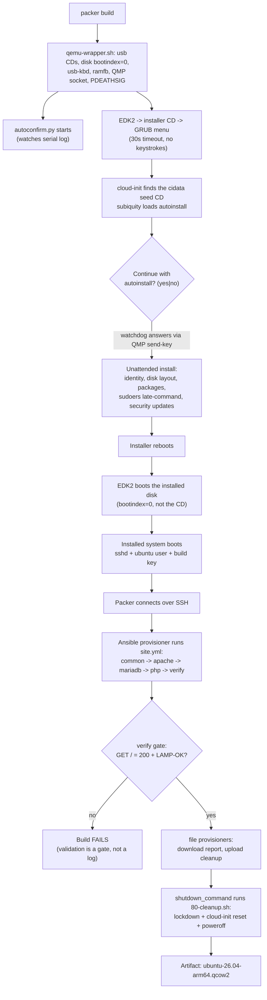

# packer-ubuntu-arm64: Ubuntu 26.04 ARM64 LAMP server golden image

An educational, file-by-file walkthrough of a Packer build that produces a
fully-updated Ubuntu Server 26.04 (arm64) "golden image" QCOW2 with a LAMP
stack (Apache, MariaDB, PHP) and Ansible installed, provisioned by a
**cross-platform Ansible playbook** (the same playbook runs on Ubuntu,
Debian, and RedHat-family systems). Built on QEMU/KVM on an aarch64 host,
next to its sibling project `../packer-windows-arm64`.

Written for engineers who have **not used Packer before**: it explains
what every file in this directory does, what each block of code is for,
why Ansible is used and how Packer invokes it, how the same Ansible code
builds Ubuntu or RedHat images - and the failures that forced each design
decision (see the Troubleshooting Journey).

## What this produces

`output/ubuntu-26.04-arm64-<version>/ubuntu-26.04-arm64.qcow2` - a
reproducible golden image containing:

- Ubuntu 26.04.1 LTS Server (kernel `7.0.0-38-generic`), **fully updated**
  (apt upgrade during the build)
- A LAMP stack: Apache 2.4.66, MariaDB 11.8.6, PHP 8.5.4 (mod_php), a
  demo database (`lampdemo` / `lampuser`) and a PHP index page
- **Ansible installed in the image** (Ubuntu's `ansible` package)
- **No working credentials** (build password locked, build SSH key
  removed) and a reset cloud-init, so deployments boot a clone and inject
  their own access via a cloud-init seed
- A machine-checked validation report
  (`reports/validation-report.json`) proving Apache + MariaDB are running
  and the PHP page answers `GET /` with `HTTP 200` - pulled out of the
  image into the repo as release evidence
- A `SHA256SUMS` next to the image

The build is fully unattended and takes about **10 minutes** on this
host: `packer build -var headless=true .` from a clean tree to artifact,
no keystrokes, no prompts, no human in the loop. Two consecutive builds
of this exact tree succeeded (10m04s and 10m15s) - repeatability is the
point.

## Packer in five minutes

Packer (HashiCorp) builds machine images - "golden images" - from one
declarative config file. You describe the VM, the installer, and the
post-install configuration; Packer boots the VM in a hypervisor, installs
the OS unattended, runs your provisioning inside it, and writes out a
disk image. The same config produces the same image every time, on any
machine that has the inputs.

The three concepts you need before reading the config:

1. **Source / builder** - the `source` block defines the VM: which
   hypervisor (QEMU here), which ISO to install from, CPU/RAM/disk, and
   how Packer will reach the installed OS. It never contains
   provisioning logic.
2. **Communicator** - once the OS is installing, Packer needs a way to
   run commands inside the guest. For Linux that is **SSH**: Packer
   forwards a host port to the guest's port 22 and authenticates with a
   key. Everything Packer does after the install happens through it.
3. **Provisioner** - `build`-block steps that run inside the guest
   through the communicator: an Ansible playbook, file uploads/downloads,
   a shutdown command.

A Packer template is HCL with exactly three top-level block types:

```hcl
packer {
  required_version = ">= 1.10.0"          # version floor
  required_plugins { qemu = { ... } }     # pinned builder plugin
}

source "qemu" "ubuntu_26_04_arm64" {
  # The VM definition: ISO, CPU, disk, firmware, communicator
}

build {
  sources = ["source.qemu.ubuntu_26_04_arm64"]
  # Provisioners: what to run inside the guest, in order
}
```

The command lifecycle mirrors that: `packer init` (download the pinned
plugins) -> `packer fmt` (canonical formatting) -> `packer validate`
(parse + sanity-check) -> `packer build` (the real thing).

Four Linux/Ubuntu terms used throughout:

- **Golden image** - a preinstalled, preconfigured template that
  deployments clone instead of installing from scratch.
- **Autoinstall** - Ubuntu's unattended installer configuration format
  (consumed by subiquity, the Ubuntu Server installer). It answers every
  installer question (locale, identity, disk layout, packages) from a
  YAML file.
- **cloud-init / NoCloud** - cloud-init is the industry-standard
  first-boot configuration engine; **NoCloud** is its simplest data
  source: a CD or disk labeled `cidata` containing `user-data` and
  `meta-data` files. Anyone booting a clone can hand it a NoCloud CD and
  have cloud-init create their users/keys on first boot.
- **qcow2** - QEMU's sparse, copy-on-write disk format: the image claims
  20 GB but only occupies what was actually written (~7.8 GB).

## The build, start to finish

What actually happens when you type `packer build .`:

1. Packer generates a QEMU command line and executes it - but
   `qemu_binary` points at `scripts/qemu-wrapper.sh`, which rewrites the
   arguments (USB CDs, input devices, disk boot order, ramfb display) and
   launches the real `qemu-system-aarch64`.
2. Packer also builds the **autoinstall seed CD**: `cd_content` renders
   `seed/user-data.tftpl` with the build SSH public key and attaches it
   as a second CD labeled `cidata`.
3. The wrapper starts `scripts/autoconfirm.py` (the confirmation
   watchdog, see below) and QEMU. The VM boots: firmware (EDK2) -> the
   installer ISO's **GRUB menu**, which does nothing and waits out its
   own 30-second timeout -> the default entry boots the Ubuntu installer.
   **No keystrokes are involved** - that is deliberate, and the
   Troubleshooting Journey explains why.
4. In the live installer environment, cloud-init's NoCloud datasource
   finds the `cidata` CD and hands the autoinstall config to subiquity.
5. Subiquity shows one safety prompt - `Continue with autoinstall?
   (yes|no)` - because the kernel command line lacks the `autoinstall`
   token (we booted the unedited default GRUB entry). The watchdog sees
   the prompt appear in the guest's serial console log and answers it
   through QMP keystrokes within seconds. The install then runs fully
   unattended.
6. Autoinstall applies the seed: locale, keyboard, the `ubuntu` user
   (with the build SSH key and a demo password), a plain direct disk
   layout, a couple of packages, and `late-commands` that install a
   NOPASSWD sudoers entry. Its default `updates: security` behavior
   applies security updates during the install.
7. The installer reboots. Because the wrapper gave the build disk
   `bootindex=0`, firmware boots the **installed system from disk**, not
   the still-attached installer CD.
8. The installed system boots; sshd comes up with the `ubuntu` user's
   authorized key. Packer connects over SSH (60-minute timeout covers
   the whole install).
9. Packer runs the **Ansible provisioner**: the playbook
   `ansible/site.yml` executes on the host, over SSH, inside the guest.
   Roles in order: `common` (full package update, base tools, install
   Ansible into the image), `apache`, `mariadb`, `php`, and `verify` - a
   validation gate that fails the build if the LAMP page does not answer
   `GET /` with `HTTP 200` and a known marker.
10. A `file` provisioner downloads the in-image validation report into
    `reports/validation-report.json`; another uploads
    `scripts/80-cleanup.sh` to the guest.
11. The `shutdown_command` runs `80-cleanup.sh` as the very last action:
    it locks the build password, removes the build SSH key, resets
    cloud-init (so clones accept a fresh NoCloud seed), does light log
    hygiene, and powers the VM off. It must run last because it removes
    the credentials Packer would need for a separate shutdown step.
12. Packer finalizes the artifact: `output/ubuntu-26.04-arm64-<version>/
    ubuntu-26.04-arm64.qcow2`.



## Directory layout

```
packer-ubuntu-arm64/
├── ubuntu-26.04-arm64.pkr.hcl             # Packer build config (source + build)
├── variables.pkr.hcl                       # Variable declarations (types, defaults)
├── ubuntu-26.04-arm64.auto.pkrvars.hcl     # Variable VALUES (gitignored)
├── ubuntu-26.04-arm64.example.pkrvars.hcl  # Tracked example of the above
├── seed/
│   ├── user-data.tftpl                     # Autoinstall seed (HCL-templated)
│   └── meta-data                           # NoCloud instance identity
├── keys/
│   └── build_ed25519(.pub)                 # Dedicated build keypair (private gitignored)
├── scripts/
│   ├── qemu-wrapper.sh                     # Fake qemu binary: arg rewrites + watchdog spawn
│   ├── autoconfirm.py                      # QMP watchdog answering subiquity's prompt
│   ├── pdeathsig-exec.py                   # Kernel-kills QEMU if the wrapper dies
│   └── 80-cleanup.sh                       # Final lockdown + cleanup (run by shutdown_command)
├── ansible/
│   ├── ansible.cfg                         # Ansible behavior for the provisioner run
│   ├── site.yml                            # The playbook Packer runs
│   └── roles/{common,apache,mariadb,php,verify}/
│       └── tasks/vars/handlers/defaults/templates per role
├── reports/
│   └── validation-report.json              # Downloaded from the built image (release evidence)
└── output/                                 # Build artifacts (gitignored)
```

Quick reference - every executable file, where it runs, and who invokes it:

| File | Runs on | Invoked by | One-line purpose |
|---|---|---|---|
| `scripts/qemu-wrapper.sh` | Linux host | Packer (`qemu_binary`) | Rewrite QEMU args for ARM virt; spawn the watchdog |
| `scripts/autoconfirm.py` | Linux host | qemu-wrapper.sh (under pdeathsig) | Answer subiquity's confirmation prompt via QMP |
| `scripts/pdeathsig-exec.py` | Linux host | qemu-wrapper.sh | Kernel-kill QEMU/watchdog if the wrapper dies |
| `scripts/80-cleanup.sh` | Ubuntu guest | `shutdown_command` | Lockdown + cleanup + poweroff (the last guest-side act) |
| `ansible/site.yml` | Host (over SSH into the guest) | Packer's `ansible` provisioner | Update + LAMP + validation gate |
| `seed/user-data.tftpl` | Rendered by Packer at build time | `cd_content` | The autoinstall seed |
| `keys/build_ed25519` | Host | Packer communicator + Ansible | SSH key Packer and Ansible authenticate with |

## Configuration files

### `ubuntu-26.04-arm64.pkr.hcl` - the build config

The main Packer template. Packer loads every `*.pkr.hcl` file in the
directory; this one holds the `packer`, `source`, and `build` blocks.

**`packer` block - version floor and plugin pinning**

```hcl
packer {
  required_version = ">= 1.10.0"
  required_plugins {
    qemu    = { source = "github.com/hashicorp/qemu",    version = "~> 1.1" }
    ansible = { source = "github.com/hashicorp/ansible", version = "~> 1.0" }
  }
}
```

Two plugins, both fetched by `packer init .`: the **qemu builder** (boots
the VM) and the **ansible provisioner** (runs the playbook - since
Packer 1.7 it is a plugin too, not built in). Pinning means anyone
checking out this repo gets the same builder and provisioner behavior -
reproducible by construction.

**Source block - the VM definition**

*Installer media and checksum*

```hcl
iso_url      = var.ubuntu_iso_path
iso_checksum = var.ubuntu_iso_checksum
```

The Ubuntu 26.04.1 live-server arm64 ISO, verified by `sha256:` digest
computed into the pkrvars file. Wrong media = refused build.

*Artifact naming*

```hcl
output_directory = "output/ubuntu-26.04-arm64-${var.image_version}"
vm_name          = "ubuntu-26.04-arm64.qcow2"
```

Versioned output directories, so successive builds never overwrite each
other (delete or move the old one before rebuilding into the same
version).

*The QEMU wrapper - the central workaround in this project*

```hcl
qemu_binary = "scripts/qemu-wrapper.sh"
```

Packer's QEMU plugin supports `qemuargs` for extra arguments - but they
**replace** the entire auto-generated command line. Instead this project
points `qemu_binary` at a wrapper script: Packer invokes it as if it were
qemu itself, and the wrapper forwards every argument with surgical
edits, appending its own devices. See `scripts/qemu-wrapper.sh` below.

*Machine, acceleration, sizing*

```hcl
machine_type = "virt"
accelerator  = "kvm"
cpu_model    = "host"
cpus      = var.cpus       # default 4
memory    = var.memory     # default 4096 MB
disk_size = var.disk_size  # default 20G
format    = "qcow2"
headless  = var.headless
```

`virt` is QEMU's ARM reference platform; `kvm` + `cpu_model = "host"`
give near-native speed on this aarch64 host. `headless = false` (the
default) opens a normal QEMU display window on the build host so you can
watch the install; `headless = true` runs with no GUI - the build log
then prints a `vnc://127.0.0.1:<port>` URL you can connect any VNC
client to if you still want to watch.

*The communicator*

```hcl
communicator         = "ssh"
ssh_username         = var.build_user          # "ubuntu"
ssh_password         = "ubuntu"               # demo fallback auth
ssh_private_key_file = "keys/build_ed25519"   # primary: key auth
ssh_timeout          = "60m"
```

How Packer talks to the guest after the install. The `ubuntu` user and
its authorized key are created by the autoinstall seed; the password is a
documented demo fallback (locked at the end of the build). The 60-minute
timeout covers the entire install, because Packer starts trying to
connect while the installer is still running.

*VirtIO devices*

```hcl
disk_interface = "virtio"
net_device     = "virtio-net"
```

Paravirtual disk and NIC - much faster than emulated hardware, and
Linux has in-box drivers, so no driver injection is needed (unlike the
Windows sibling project).

*EFI firmware*

```hcl
efi_boot          = true
efi_firmware_code = "/usr/share/edk2/aarch64/QEMU_EFI-pflash.raw"
efi_firmware_vars = "/usr/share/edk2/aarch64/vars-template-pflash.raw"
```

ARM64 servers boot via UEFI, so the VM uses the standard EDK2 armvirt
firmware (Arch's `edk2-aarch64` package). Packer copies the vars image
into the output directory (`efivars.fd`) so the guest can persist EFI
variables. No Secure Boot and no TPM are needed for Ubuntu Server, so
none are configured (the Windows sibling needs both - see its README).

*The autoinstall seed CD*

```hcl
cd_content = {
  "user-data" = templatefile("seed/user-data.tftpl", {
    build_pubkey = trimspace(file("keys/build_ed25519.pub"))
  })
  "meta-data" = file("seed/meta-data")
}
cd_label = "cidata"
```

`cd_content` builds files into a small extra ISO at build time. This is
how the installer gets its instructions and how the build SSH key gets
into the image without committing any secret: `templatefile()` renders
the seed with the **public** key from `keys/build_ed25519.pub`, and only
the matching private key is kept off git (it is gitignored). `cd_label =
"cidata"` names the volume so cloud-init's NoCloud datasource finds it
by label - no HTTP server involved anywhere.

*No boot_command at all*

The template deliberately has **no `boot_command`** (the usual mechanism
for typing installer keystrokes over VNC). The ISO's own GRUB menu has a
30-second timeout, so the default entry boots itself; the one remaining
interactive gate - subiquity's confirmation prompt - is answered by the
watchdog instead. Two attempts at keystroke-based boot automation both
failed on this host for timing reasons; see the Troubleshooting Journey.

*Shutdown configuration*

```hcl
shutdown_command = "sudo sh /tmp/80-cleanup.sh ${var.build_user}"
shutdown_timeout = "30m"
```

`shutdown_command` is the last command Packer runs in the guest. Here it
invokes the uploaded `80-cleanup.sh`, which strips the build credentials
and then powers the VM off itself - it must be this way, because after
the script removes the SSH key, Packer could not open a new session to
run a separate shutdown command.

**Build block - what runs inside the guest**

```hcl
build {
  name    = "ubuntu-26-04-arm64-lamp"
  sources = ["source.qemu.ubuntu_26_04_arm64"]

  provisioner "ansible" {
    playbook_file    = "ansible/site.yml"
    extra_arguments  = ["-v"]
    ansible_env_vars = [
      "ANSIBLE_CONFIG=ansible/ansible.cfg",
      "ANSIBLE_HOST_KEY_CHECKING=False",
    ]
  }

  provisioner "file" {
    direction   = "download"
    source      = "/var/lib/image-build/validation-report.json"
    destination = "reports/validation-report.json"
  }

  provisioner "file" {
    direction   = "upload"
    source      = "scripts/80-cleanup.sh"
    destination = "/tmp/80-cleanup.sh"
  }
}
```

Provisioners run in the listed order: the Ansible playbook (everything
above ran through it), then the report download (release evidence into
the repo), then the cleanup upload for the `shutdown_command`. The
Ansible provisioner itself is the heart of the build - the next two
sections are dedicated to it.

### `variables.pkr.hcl` - variable declarations

Declares every input with a type, description, and default:

| Variable | Type | Default | Purpose |
|---|---|---|---|
| `ubuntu_iso_path` | string | - | Path to the live-server arm64 ISO |
| `ubuntu_iso_checksum` | string | - | `sha256:` checksum of that ISO |
| `image_version` | string | `1.0.0` | Semver stamped into the output dir |
| `build_user` | string | `ubuntu` | Build account the seed creates |
| `headless` | bool | `false` | `true` = QEMU with no GUI window |
| `cpus` / `memory` / `disk_size` | - | 4 / 4096 / `20G` | VM sizing |

### `ubuntu-26.04-arm64.auto.pkrvars.hcl` - variable values

Packer auto-loads any `*.auto.pkrvars.hcl` in the build directory. This
one holds the actual values: the ISO path, its checksum, and the image
version. It is **gitignored** (`.gitignore` excludes `*.auto.pkrvars.hcl`
because such files often hold secrets); the tracked
`ubuntu-26.04-arm64.example.pkrvars.hcl` shows the shape. Copy the
example, fill in the real checksum (`sha256sum <iso>`), and you are set.

### `seed/user-data.tftpl` - the autoinstall seed

The installer's answer file. Rendered by `templatefile()` at build time,
so `${build_pubkey}` is an HCL substitution - the same public key Packer
will later authenticate with. Key by key:

- `#cloud-config` header - required for cloud-init to recognize the file
  as cloud-config (the `autoinstall:` tree lives inside it).
- `autoinstall.version: 1` - the config format version.
- `locale` / `keyboard` - answers the installer's first screens.
- `identity` - creates the `ubuntu` user with a hashed demo password
  (`openssl passwd -6` of `ubuntu`; documented, and locked at the end of
  the build). A password is mandatory for the account, but the real
  access is the SSH key.
- `ssh.install-server: true` + `allow-pw: true` + `authorized-keys` -
  installs openssh-server into the target and puts the build public key
  into the `ubuntu` user's authorized_keys.
- `storage.layout.name: direct` - plain single-partition-ish direct
  layout with no LVM (LVM would also work; direct keeps the image
  simple and resizable by the consumer).
- `packages` - a couple of extras installed at install time
  (`qemu-guest-agent` so hypervisors can query the guest, `curl`).
- `late-commands` - run at the very end of the install, inside the
  target: (1) write a NOPASSWD sudoers entry so Packer's shutdown and
  Ansible's `become` can use sudo over SSH without a TTY or password;
  (2) belt-and-braces: append the same build key to authorized_keys in
  case the `ssh.authorized-keys` directive behaves differently on a
  future installer version (a duplicate line is harmless).
- Autoinstall's default `updates: security` behavior (not configured,
  hence default) applies security updates during the install - part of
  why the image ships fully updated.

A note on delivery: the seed is a **CD, not an HTTP server**. Most
Packer+Ubuntu tutorials serve `user-data` over Packer's built-in HTTP
server and add `ds=nocloud;s=http://...` to the kernel command line
(which requires editing GRUB at boot). Labeling a CD `cidata` achieves
the same with zero boot-time interaction - cloud-init scans block
devices for that label. That choice is what makes the "boot the default
GRUB entry and let the watchdog answer the prompt" strategy possible.

### `seed/meta-data` - NoCloud instance identity

Two lines: a stable `instance-id` and a hostname. cloud-init requires
both files to exist; the seed CD is the pair.

## Why Ansible, and how Packer calls it

**Division of labor.** Packer's job is the *machine*: boot it, install
it, connect to it, and write the artifact. Configuration of the
installed OS is a separate discipline, and shell scripts make a poor
tool for it: they are not idempotent (running twice behaves
differently), they hardcode distro specifics (`apt` vs `dnf`,
`apache2` vs `httpd`), and they have no built-in notion of "check the
desired state, then change only what differs". Ansible exists precisely
for that: you declare outcomes (`package present`, `service started`,
`file templated`), Ansible computes the diff against the live system,
and only changes what is wrong - the second run reports `ok` with
`changed=0`. That idempotence is why the playbook is safe to re-run on
any machine, and why it doubles as a standalone config tool (see
"Building Ubuntu or RedHat" below).

**The mechanics - what actually happens at `provisioner "ansible"`.**

1. Packer generates a **temporary inventory file** describing the single
   build VM: the forwarded SSH port (`127.0.0.1:<random>`), the username
   (`ubuntu`), and the communicator's private key
   (`keys/build_ed25519`). You never write an inventory.
2. Packer runs `ansible-playbook -i <generated-inventory> ansible/site.yml`
   **on the build host** (it needs ansible-core installed there - no
   Ansible inside the guest is required to *run the playbook*; the
   image gets Ansible installed anyway because the requirement asked
   for it, via the `common` role).
3. Each task opens an SSH session (or reuses a pipelined one), ships a
   small Python snippet to the guest, executes it there, and returns
   JSON results. The modules run **in the guest**; the playbook runs on
   the host.
4. `become: true` in the playbook makes every task escalate to root via
   `sudo` - which works non-interactively because the seed's
   `late-commands` installed the NOPASSWD sudoers entry.
5. The block's settings tune the run: `extra_arguments = ["-v"]` for
   verbose per-task output in the build log; `ansible_env_vars` pins
   `ANSIBLE_CONFIG` to this project's `ansible/ansible.cfg` (so the
   host's global `/etc/ansible/ansible.cfg` cannot change behavior)
   and disables host-key checking (the VM's host key is new every
   build).
6. **Failure semantics**: any task that fails (red) fails the play; a
   failed play makes the `ansible-playbook` process exit non-zero; the
   provisioner treats that as a failed build. The `verify` role leans
   on this deliberately - it is a *gate*, not a log line.

**Why only `ansible.builtin` modules.** Ansible collections
(`community.mysql`, etc.) would add an `ansible-galaxy install` step to
every build and a network dependency. This playbook uses only builtins
(`package`, `service`, `template`, `command`, `uri`, `service_facts`,
`assert`, ...) - so it runs with a bare `ansible-core` install, fully
offline-capable. That constraint is why the MariaDB role drives the
`mysql` CLI instead of `community.mysql` modules (see below).

## Deep dive: the Ansible playbook

### `ansible/site.yml` - the play

```yaml
- name: LAMP server image build
  hosts: all
  become: true
  gather_facts: true
  roles:
    - common
    - apache
    - mariadb
    - php
    - verify
```

- `hosts: all` - run on every machine in Packer's generated inventory
  (exactly one: the build VM). Standalone use: `ansible-playbook -i
  <host>, ansible/site.yml` runs it against any machine.
- `become: true` - every task escalates to root via sudo.
- `gather_facts: true` - collects `ansible_facts` before any task. This
  matters: the fact `ansible_facts['os_family']` (`Debian` or `RedHat`)
  is what the whole cross-platform design pivots on.
- `roles:` - five roles, strictly in order: update + prerequisites,
  web server, database, PHP integration, then the gate.

### The cross-platform mechanism

Every role begins with the same three lines of machinery:

```yaml
- name: Load distribution-specific variables (common)
  ansible.builtin.include_vars: "{{ lookup('ansible.builtin.first_found', params) }}"
  vars:
    params:
      files:
        - "{{ ansible_facts['distribution'] }}.yml"   # e.g. Ubuntu.yml, Rocky.yml
        - "{{ ansible_facts['os_family'] }}.yml"      # Debian.yml, RedHat.yml
      paths:
        - "{{ role_path }}/vars"
```

The `first_found` lookup tries the most specific filename first
(distribution) and falls back to family. Every task then references
**generic variable names** (`{{ apache_package }}`,
`{{ db_service }}`) instead of hardcoding distro specifics. The
differences live entirely in two small files per role:

| Generic name | `vars/Debian.yml` (Ubuntu) | `vars/RedHat.yml` (RHEL/Rocky/Alma) |
|---|---|---|
| `apache_package` / `apache_service` | `apache2` | `httpd` |
| `apache_user` / `apache_group` | `www-data` | `apache` |
| `apache_docroot` | `/var/www/html` | `/var/www/html` |
| `php_packages` | `php`, `libapache2-mod-php`, `php-mysql` | `php`, `php-mysqlnd`, `php-fpm` |
| `db_packages` | `mariadb-server`, `python3-pymysql` | `mariadb-server`, `python3-PyMySQL` |
| `db_service` | `mariadb` | `mariadb` |
| `ansible_packages` | `ansible` (universe) | `ansible-core` (AppStream) |

The handful of tasks that cannot be expressed generically (Debian's
`ufw` vs RedHat's `firewalld`; mod_php vs php-fpm wiring) carry an
explicit guard:

```yaml
when: ansible_facts['os_family'] == 'Debian'   # or 'RedHat'
```

so exactly one branch runs per host. **Nothing in the playbook hardcodes
Ubuntu**: on a RedHat-family host the same tasks resolve `httpd`,
`php-fpm`, and `python3-PyMySQL` and run the RedHat branch of each
guard.

### Role 1: `common` - update, tools, and Ansible-in-the-image

- `apt: update_cache + upgrade: dist` (Debian family) or
  `dnf: name='*' state=latest` (RedHat family) - this is the "update the
  ISO" requirement: the image ships with every package at the latest
  available version.
- `package: base_packages` - a few universal tools (`curl`, `vim`,
  `wget`, `ca-certificates`) via the generic package module.
- `package: ansible_packages` - **installs Ansible into the image**
  (Ubuntu's `ansible` from universe; RedHat's `ansible-core` from
  AppStream), so the deployed server can run playbooks itself.

### Role 2: `apache` - the web server

- Install `{{ apache_package }}`, enable + start `{{ apache_service }}`.
- Template `templates/index.php.j2` to
  `{{ apache_docroot }}/index.php` - the validation page. It prints a
  marker line (`LAMP-OK PHP <version>`) and a module listing; the verify
  role greps for the marker.
- **Remove the stock placeholder `index.html`** (Debian family only -
  httpd ships no index.html). Without this, Apache's DirectoryIndex
  serves `index.html` ahead of `index.php`, and `GET /` answers with
  Ubuntu's placeholder page instead of the LAMP page. The end-to-end
  clone test caught exactly this on the first completed image (see the
  Journey).
- Firewall ports 80/443 - only if a firewall is *actually active*
  (`ufw status` / `firewalld --state` probed first, `failed_when:
  false` so a missing tool is not an error). The build VM has no active
  firewall; a hardened deployment might - the role handles both
  idempotently.
- Handler: `Restart Apache` (notified by installs/changes - restarts
  only when something actually changed).

### Role 3: `mariadb` - the database

- Install `{{ db_packages }}` (server + Python bindings), enable +
  start `{{ db_service }}`.
- Remove anonymous accounts and the `test` database - the useful part
  of `mysql_secure_installation`, done declaratively.
- Create the demo database and user, idempotently. The
  `community.mysql` modules would be the idiomatic tool, but this
  playbook is **builtin-only** - so the role uses the `mysql` CLI as
  root (MariaDB's unix_socket auth means root needs no password) via
  the `command` module with `argv:` lists (no shell quoting issues),
  guarded by a check-then-create pattern:

```yaml
- name: Check whether the demo database exists
  ansible.builtin.command:
    argv: [mysql, -N, -B, -e, "SHOW DATABASES LIKE '{{ lamp_db_name }}';"]
  register: lamp_db_exists
  changed_when: false

- name: Create the demo database
  ansible.builtin.command:
    argv: [mysql, -e, "CREATE DATABASE {{ lamp_db_name }} ...;"]
  when: lamp_db_exists.stdout | trim | length == 0
```

  The demo credentials live in `defaults/main.yml`
  (`lampdemo` / `lampuser` / `lamppassword`) - override them with
  `--extra-vars` for any real use.

### Role 4: `php` - the language

Install `{{ php_packages }}` and restart Apache. The per-family package
lists are the whole story: Debian's `libapache2-mod-php` embeds PHP in
Apache (auto-enabled at install); RedHat's stack is `php` + `php-fpm`
with httpd proxying to the FPM pool, so the RedHat branch also enables +
starts the `php-fpm` service. One playbook, two integration models,
selected by the vars file.

### Role 5: `verify` - the validation gate

The build must not ship an image that only *looks* right. The role:

1. `service_facts:` - enumerate services.
2. Resolve Apache's and MariaDB's state with a regex over the facts
   dict (matching `apache2` or `apache2.service` - systemd report
   formats vary), defaulting to `not-found`.
3. `uri: GET http://localhost/` - captured, not fatal, so the report
   can include the actual result either way. Note it fetches `/` - the
   real-world path - not `/index.php`; that specificity is a lesson
   from the Journey (a placeholder index.html once shadowed the PHP
   page while `/index.php` still answered fine).
4. Assemble and write the report to
   `/var/lib/image-build/validation-report.json` **inside the image** -
   then the build's `file` provisioner downloads it into the repo's
   `reports/` as release evidence:

```json
{
    "apache_service": "apache2",
    "apache_state": "running",
    "distribution": "Ubuntu 26.04",
    "lamp_page_marker": true,
    "lamp_page_status": 200,
    "mariadb_state": "running",
    "os_family": "Debian",
    "timestamp_utc": "2026-10-01T15:31:53Z"
}
```

5. `assert:` that Apache is running, MariaDB is running, the page
   answered 200, and the marker is present. **A failed assert fails the
   play, which fails the build.** A broken LAMP image cannot leave the
   pipeline quietly.

### `ansible/ansible.cfg` - behavior for the provisioner run

Pinned via `ANSIBLE_CONFIG` in the provisioner block so the host's
global `/etc/ansible/ansible.cfg` cannot leak in. It disables host-key
checking (new VM host key every build), disables retry-file litter,
and enables SSH pipelining (fewer round trips per task). The inventory
always comes from Packer's `-i`.

## Building Ubuntu or RedHat with this code

The project splits cleanly along one seam: **the installer is
distro-specific; the configuration is not.**

| Layer | Ubuntu 26.04 (this project) | RedHat-family (Rocky/Alma/RHEL aarch64) |
|---|---|---|
| Installer ISO | live-server arm64 ISO | the distro's aarch64 DVD/boot ISO |
| Unattended install config | `seed/user-data.tftpl` - **autoinstall** YAML on a `cidata` CD | a **kickstart** `.ks` file, typically also on a CD, referenced by the `inst.ks=` kernel argument |
| Boot automation | GRUB default entry (30s timeout) + `autoconfirm.py` answering subiquity's prompt | Anaconda reads the kickstart without subiquity's confirmation prompt; a boot edit is usually needed to point at it |
| QEMU plumbing | `scripts/qemu-wrapper.sh` - **identical** (USB CDs and disk bootorder are ARM-virt problems, not distro problems) |
| Provisioning | `ansible/site.yml` - **identical, unchanged**: roles load `vars/RedHat.yml` and take the RedHat branch of each guarded task |

**To build another Ubuntu release**: drop in the new live-server arm64
ISO, update the path + checksum in the pkrvars file, bump
`image_version`, build. The autoinstall schema is stable across
releases; if a future installer renames a key, subiquity validates the
seed at install time and names the offending section in the serial log.

**To build a RedHat-family image**: copy this project, swap the ISO and
checksum, and replace the seed with a kickstart equivalent - create the
user with the same build key, `poweroff` at the end, and attach it as a
CD (Anaconda finds kickstarts via `inst.ks=hd:...` or the label; you
would likely restore a small `boot_command` for the GRUB edit, since
Anaconda has no equivalent of subiquity's answerable confirmation
prompt). The wrapper's ARM-virt fixes apply unchanged. The **Ansible
playbook needs zero changes** - that was the design requirement, and
it is achieved by the vars-per-family mechanism above rather than by
`when:` soup.

**To configure an existing machine** (no Packer at all): the playbook
is a plain playbook. `ansible-playbook -i myserver, ansible/site.yml`
(become requires sudo rights on the target) applies the same update +
LAMP to any Ubuntu, Debian, Rocky, Alma, or RHEL host. This is the
second life of the code: the image build is just one consumer.

**What is actually verified**: the Ubuntu path is proven end-to-end by
build + clone test; the RedHat path is verified by
`ansible-playbook --syntax-check` and review of every family
conditional, but has not been built live (no RHEL-family ISO was in
scope). Exercising it against a Rocky/Alma aarch64 ISO is the natural
next step if you need that proof.

## Running the build

Prerequisites on the build host (all present on the machine this was
built on):

- Packer >= 1.10 (1.16.1 here)
- `qemu-system-aarch64` with KVM (an aarch64 host; `/dev/kvm` accessible)
- EDK2 armvirt firmware at
  `/usr/share/edk2/aarch64/{QEMU_EFI-pflash.raw,vars-template-pflash.raw}`
  (Arch `edk2-aarch64`)
- `ansible-core` on the host (the provisioner runs `ansible-playbook`
  locally; 2.21.4 here)
- Python 3 (the watchdog and PDEATHSIG helper are stdlib-only)
- The Ubuntu 26.04.1 live-server arm64 ISO, plus its sha256

One-time setup:

```bash
cd packer/packer-ubuntu-arm64

# A dedicated SSH keypair for builds. The private key is gitignored
# (*.pkrvars.hcl and *_ed25519 rules); the public key is committed and
# baked into the image by the seed.
ssh-keygen -t ed25519 -f keys/build_ed25519 -N '' -C packer-ubuntu-arm64-build

# Local values: copy the example and fill in the real ISO checksum
cp ubuntu-26.04-arm64.example.pkrvars.hcl ubuntu-26.04-arm64.auto.pkrvars.hcl
# ... edit ubuntu_iso_path / ubuntu_iso_checksum (sha256sum <iso>)

packer init .            # fetch the pinned qemu + ansible plugins
packer fmt -recursive .  # canonical HCL formatting
packer validate .        # parse + sanity-check
```

First run - watch it work (a QEMU window opens on the host):

```bash
PACKER_LOG=1 packer build -on-error=ask .
```

What you will see in the window: firmware text, then the Ubuntu GRUB
menu sitting still for ~30 seconds (that is correct - the default entry
boots itself), then the installer's console output, a progress burst of
curtin/package installation, a reboot, and the installed system's boot.
`-on-error=ask` lets you pause and inspect the VM if something fails;
`PACKER_LOG=1` gives verbose phase logging.

Fully automated (no window, CI-friendly):

```bash
packer build -var headless=true .
```

A headless build prints a `vnc://127.0.0.1:<port>` URL in the first
minute - open it with any VNC client to watch anyway.

What the ~10 minutes look like in the log:

- `Waiting for SSH to become available...` - most of the install
  happens under this line. `SSH handshake err ... unable to
  authenticate` lines during this phase are **expected noise**: the
  live installer runs its own sshd which rejects the target system's
  credentials; Packer keeps retrying and connects once the installed
  system boots.
- `Qemu stdout: answered confirmation prompt (answer 1 of max 3)` -
  the watchdog doing its job, about 1-2 minutes in.
- `Provisioning with Ansible...` then one line per task, ending with
  `PLAY RECAP` - the recap should read `failed=0` (and on a rebuild of
  an identical system, `changed=0`).
- `80-cleanup: password locked, build key removed, cloud-init reset
  (issues: 0)` - the final lockdown ran clean.
- `Build '...' finished after N minutes.`

If a build errors or you cancel it, teardown is guaranteed by
PDEATHSIG - no orphaned QEMU survives. If one somehow does:
`pkill -f qemu-system-aarch64`. Note that `packer validate` errors with
"output directory already exists" if a previous build's output is still
there - delete or version-bump before rebuilding.

## Post-build

```bash
qemu-img check output/ubuntu-26.04-arm64-1.0.0/ubuntu-26.04-arm64.qcow2
qemu-img info  output/ubuntu-26.04-arm64-1.0.0/ubuntu-26.04-arm64.qcow2

(cd output/ubuntu-26.04-arm64-1.0.0 && sha256sum ubuntu-26.04-arm64.qcow2 > SHA256SUMS)

cat reports/validation-report.json
```

The output directory also contains `efivars.fd` - the firmware variable
store snapshot, which is machine-specific state and **not** part of the
distributable artifact; you ship the QCOW2 (this mirrors the Windows
project).

## Using the image (cloud-init ready)

The image ships with **no working credentials** - by design. The build
account's password is locked and its SSH key removed, so the only way
in is what the *deployment* provides. The mechanism is cloud-init: the
build's last step reset it, so the first boot of a clone accepts a
fresh NoCloud seed and configures itself.

```bash
# 1. Build a seed CD for your deployment (label cidata, two files)
mkdir -p seedtest
cat > seedtest/user-data <<'EOF'
#cloud-config
users:
  - name: myuser
    sudo: ALL=(ALL) NOPASSWD:ALL
    shell: /bin/bash
    ssh_authorized_keys:
      - ssh-ed25519 AAAA... myuser
EOF
printf 'instance-id: lamp-clone-001\nlocal-hostname: lamp-server\n' > seedtest/meta-data
xorriso -as mkisofs -o seed.iso -V cidata -r seedtest/user-data seedtest/meta-data

# 2. Boot a copy (overlay clone: the base image stays pristine)
qemu-img create -f qcow2 -b output/ubuntu-26.04-arm64-1.0.0/ubuntu-26.04-arm64.qcow2 \
  -F qcow2 clone.qcow2
qemu-system-aarch64 -M virt -cpu host -accel kvm -m 1024 -smp 2 \
  -display none -daemonize \
  -bios /usr/share/edk2/aarch64/QEMU_EFI.fd \
  -device qemu-xhci,id=usb \
  -drive file=clone.qcow2,if=virtio \
  -drive file=seed.iso,format=raw,if=none,id=cd0 -device usb-storage,drive=cd0 \
  -device virtio-net,netdev=n0 \
  -netdev user,id=n0,hostfwd=tcp::2222-:22,hostfwd=tcp::8080-:80

# 3. Log in with your key, and use the LAMP stack
ssh -p 2222 myuser@127.0.0.1
curl -s http://127.0.0.1:8080/          # -> LAMP-OK PHP 8.5.4 ...
```

Two details in that command pair are the ARM-virt lessons again: the
seed CD is attached as `usb-storage` behind a `qemu-xhci` controller
(ARM `virt` firmware cannot see Packer/QEMU's default CD attachment),
and the clone is an overlay so the golden image itself is never dirtied
by first-boot state. This exact workflow is the project's end-to-end
test - see the Journey's last entry.

## Demo credentials (build time only)

- Build account: `ubuntu` / `ubuntu` - the password is locked and the
  authorized key removed by `scripts/80-cleanup.sh` at the end of the
  build. It does not work on the shipped image (verified: SSH
  `Permission denied`).
- The `ubuntu` user retains NOPASSWD sudo
  (`/etc/sudoers.d/90-build-user`) - pair it with your own seed-provided
  key, or remove the file in your deployment seed if you do not want it.
- Demo MariaDB database: `lampdemo`, user `lampuser` / `lamppassword`
  (localhost only; see `ansible/roles/mariadb/defaults/main.yml`).

## Diagnostics when a build goes wrong

- `/tmp/packer-serial.log` - the guest's serial console: kernel boot,
  subiquity's phase log (`start:/finish: subiquity/...`), curtin
  install progress, and the confirmation prompt text. Almost every
  diagnosis in the Journey started here. The wrapper deletes it at VM
  start, so it always reflects the current build.
- `/tmp/qemu-wrapper.cmd.log` - the exact final QEMU command line the
  wrapper ran. Check this first if the VM misbehaves (device wiring,
  firmware, CD topology).
- `/tmp/packer-qmp.sock` - the VM's QMP control socket while a build
  runs. You can screendump the display (`screendump` command) or inject
  keystrokes (`send-key`) - the `autoconfirm.py` source is a working
  example of both, and the salvage in the Journey used `send-key`
  interactively.
- Build log markers: `Qemu stdout: ...` lines are the wrapper's
  watchdog output; `PLAY RECAP` is Ansible's summary; the `80-cleanup:`
  line is the final lockdown report.
- If you alter any guest-executed file, keep it **pure ASCII** - a repo
  rule inherited from the Windows project, where a single UTF-8 em-dash
  silently broke a guest script parser.

## scripts/ walkthrough

### Host-side scripts

#### `scripts/qemu-wrapper.sh` - the fake qemu binary

Packer runs it as `qemu_binary`; it behaves like
`qemu-system-aarch64` with Packer's arguments, plus fixes. Block by
block:

1. **Header** - documents why a wrapper instead of `qemuargs`
   (replacement, not append).
2. **Stale-state hygiene** - removes any leftover
   `/tmp/packer-qmp.sock` (a stale socket makes QEMU's `-qmp server`
   fail to bind and kills the VM at launch) and the old serial log
   (so the watchdog only ever sees this run's output).
3. **Teardown trap** - kills QEMU and the watchdog on EXIT/TERM/INT.
   The *real* guarantee is PDEATHSIG (below); traps alone leaked
   processes when Packer tore the wrapper down with an untrappable
   signal - a lesson inherited from the Windows project.
4. **The argument-rewrite loop** - walks Packer's argv:
   - `-drive ...,media=cdrom` -> rewritten to `if=none,id=cd-pkr-N` +
     an explicit `usb-storage` device. **ARM `virt` has no IDE/SATA
     controller**, so Packer's default CD attachment is invisible to
     the firmware; USB CD-ROMs are the only thing it can boot. The
     first CD (the install ISO) sits on `usb.0` next to the input
     devices; every later CD (the seed) goes to the second controller
     `usb2.0` - on a single bus, a 5th USB device makes QEMU silently
     insert a 12 Mb/s full-speed hub whose slow enumeration can push
     boot past Packer's timing (a lesson the Windows project paid
     for).
   - `-drive ...,if=virtio` (the build disk) -> rewritten to
     `virtio-blk-pci,drive=hd0,bootindex=0`. Packer's anonymous
     virtio disk has no bootindex, so firmware boot order between
     disk and CD is whatever enumeration produced. With
     `bootindex=0`, the **disk is the first boot device** - which is
     exactly right for the post-install reboot - while the empty disk
     at first boot makes firmware fall through to the installer CD
     anyway. One flag makes both boots correct.
5. **`bus_extras`** - devices appended to the invocation: two
   `qemu-xhci` controllers, `usb-kbd` + `usb-tablet` (without a
   keyboard device, VNC keystrokes go nowhere), `ramfb` (ARM `virt`
   has no display device of its own), `-serial file:...` (the
   diagnostic console), `-qmp unix:...` (the control socket).
6. **Watchdog spawn** - starts `scripts/autoconfirm.py` under
   `pdeathsig-exec.py`, so it dies whenever the wrapper dies, however
   it dies.
7. **Invocation logging + launch** - writes the final command line to
   `/tmp/qemu-wrapper.cmd.log`, then launches QEMU in the background
   under `pdeathsig-exec.py`, waits, and propagates its exit code.

#### `scripts/autoconfirm.py` - the confirmation watchdog

The bridge over the one interactive gate left in the installer boot.
Subiquity, on finding autoinstall data without the `autoinstall`
keyword on the kernel command line, asks
`Continue with autoinstall? (yes|no)` and waits - indefinitely. This
script:

1. Waits up to 120 s for the QMP socket to appear.
2. Polls the serial log every 2 s, reading only new content (with a
   one-prompt-length overlap so a prompt split across two reads is
   still seen; a truncated file resets the position).
3. On seeing the prompt: waits 5 s for it to finish rendering, then
   types `y`, `e`, `s`, `Enter` through QMP `send-key` (0.4 s apart -
   QMP `keys` are chords, so sequential typing means one command per
   key).
4. Consumes the log up to the current size so the answered prompt
   cannot re-trigger; a genuinely new prompt occurrence would be
   answered too, up to a maximum of 3 (bounded automation).
5. Exits when the QMP socket disappears (QEMU gone) or after 90
   minutes.

It is safe to answer automatically because this prompt only ever
appears for this build's throwaway VM disk, and only when subiquity
already has a valid seed (the entire point is a consent gate for
interactive humans). The mechanism - QMP `send-key` - was proven
interactively first: a build stuck on that prompt was un-stuck by hand
through the same socket before the watchdog automated it.

#### `scripts/pdeathsig-exec.py` - guaranteed child teardown

Inherited unchanged from the Windows project. `prctl(
PR_SET_PDEATHSIG, SIGKILL)` + `os.execvp()`: the kernel kills the child
the instant its parent dies, however it dies (including the SIGKILL
Packer uses on teardown, which no bash trap can catch). The rule it
enforces: never launch its children with daemonizing flags, because a
fork clears the parent-death signal.

### Guest-side scripts

#### `scripts/80-cleanup.sh` - lockdown, cleanup, poweroff

Runs as root via the `shutdown_command` (with the build user as `$1`)
- the **very last** guest-side act, because it removes the credentials
Packer would need for anything after it:

1. `passwd -l ubuntu` - lock the demo build password.
2. Remove the build key from authorized_keys.
3. `cloud-init clean --logs` - reset cloud-init state. Subiquity
   otherwise pins the image to `datasource_list: [None]` in
   `/etc/cloud/cloud.cfg.d/99-installer.cfg`, which would make clones
   ignore a fresh NoCloud seed; after `clean`, the next boot behaves
   like a first boot and reads whatever seed the deployment attaches.
4. Light hygiene: `apt-get clean`, journal rotation/vacuum, log
   truncation. **No free-space zeroing** - the repo-wide lesson from
   the Windows project (zeroing fills the disk to 100% and starves the
   shutdown path; compaction, if ever wanted, is a host-side
   `qemu-img convert`).
5. `systemctl poweroff` (with fallbacks) - the script powers the VM off
   itself; Packer's `shutdown_timeout` (30m) covers the wait.

Every step is `|| FAIL=1` soft: cleanup reports issues but always
reaches the poweroff, so a cosmetic failure can never wedge a finished
build.

## Troubleshooting Journey

Every design decision above exists because a specific failure happened
on this hardware. The complete record, in order:

### Phase 1: Getting the installer to boot at all

**1. CDs invisible to ARM virt firmware (inherited lesson)**
- Symptom: the VM boots to firmware and finds no bootable media.
- Root cause: ARM `virt` has no IDE/SATA; QEMU's default CD attachment
  does not exist as far as the firmware is concerned.
- Fix (from `../packer-windows-arm64`): the wrapper's CD-to-usb-storage
  rewrite plus dual `qemu-xhci` controllers and the second-CD-on-usb2.0
  bus rule.

### Phase 2: Boot automation - three attempts

**2. VNC GRUB-edit, first attempt: keystrokes lost in POST**
- Symptom: the VM sat at subiquity's `Continue with autoinstall?
  (yes|no)` prompt; the serial log ended with
  *"Add 'autoinstall' to your kernel command line to avoid this"* and
  the booted kernel cmdline showed the stock
  `BOOT_IMAGE=/casper/vmlinuz --- console=tty0` - the unedited default
  entry.
- Root cause: the plan was to VNC-type a GRUB edit (`e`, two downs,
  append `autoinstall ds=nocloud`, F10). Firmware POST + USB CD
  enumeration on this host is nondeterministic (tens of seconds), and
  `boot_wait = "5s"` typed the entire edit **while the firmware was
  still on screen** - every keystroke lost. Also spotted in review:
  the typed text lacked a leading space and would have corrupted
  `console=tty0`.
- Fix direction: remove all boot-time keystroke dependency.

**3. QEMU `-kernel` direct boot: deterministic installer, infinite
reinstall loop**
- Symptom: a rewritten wrapper booting
  `-kernel/-initrd/-append "autoinstall ds=nocloud console=tty0"` gave
  a perfectly unattended install - then **rebooted into the installer
  again**. Five boots, ~450 s each, each one re-partitioning the disk;
  Packer's SSH attempts bounced off the live installer's sshd forever.
- Root cause: the fw_cfg kernel **always wins over every boot entry,
  on every reset**. The post-install reboot - meant to boot the
  installed disk - re-ran the installer. Direct kernel boot and
  golden-image builds are fundamentally incompatible here.
- Diagnosis method: counting `Kernel command line:` lines in
  `/tmp/packer-serial.log` (one per boot) and comparing them - five
  identical `-append` cmdlines is a loop, not a boot.
- Fix: dropped `-kernel`; the disk got `bootindex=0` instead (see 5).

**4. Stale QMP socket kills the next launch**
- Symptom: a rebuilt VM died instantly at launch.
- Root cause: `/tmp/packer-qmp.sock` left behind by the killed run;
  QEMU's `-qmp unix:...,server` cannot bind an existing socket.
- Fix: the wrapper deletes the socket (and the serial log) at start.

**5. VNC GRUB-edit, second attempt: menu caught, edit still lost**
- Symptom: same confirmation halt as (2), despite a ~320 s window of
  inert `down/up` keystroke pairs (observed live: the GRUB selector
  visibly cycled - so keystrokes *were* reaching the menu).
- Root cause: either the menu's countdown was not actually paused by
  arrow keys, or the `e`-edit sequence itself failed silently - with
  no way to distinguish from outside the display. The lesson: any
  design that depends on VNC keystroke *content* landing correctly is
  fragile on this host, even when key *delivery* is proven.
- Fix: stop trying. Boot the default entry (the ISO's own 30 s GRUB
  timeout is deterministic) and deal with the one prompt that
  remains.

**6. QMP `send-key` salvage - the manual proof**
- With the third build parked on the confirmation prompt, the prompt
  was answered **by hand** through the QMP socket: four `send-key`
  commands (`y`, `e`, `s`, `Enter`, 0.4 s apart). The install ran to
  completion, the `bootindex=0` disk booted the installed system, SSH
  connected, the playbook ran, and the build finished (23m23s) - the
  first complete end-to-end success, proving every other component
  worked and isolating the prompt as the only gap.
- Fix: automate exactly that action - `scripts/autoconfirm.py`,
  spawned by the wrapper, reacting to the prompt appearing in the
  serial log. Builds since: fully unattended, ~10 minutes.

**7. SSH auth-failure noise during the install (not a fault)**
- Symptom: hundreds of `ssh: unable to authenticate` handshake errors
  in the build log during the install phase.
- Root cause: `ssh: install-server: true` in the seed also runs an
  sshd **in the live installer environment**, which rejects the target
  system's credentials. Packer's `Detected authentication error.
  Increasing handshake attempts` handling keeps retrying until the
  installed system's sshd answers.
- Resolution: recognized as benign; documented so the next reader does
  not chase it.

### Phase 3: Provisioning

**8. `packer validate` rejects a literal `${...}` in a template
comment**
- Symptom: `templatefile()` parse error pointing into
  `seed/user-data.tftpl`.
- Root cause: a comment in the seed contained the literal text
  `${...}`; HCL's template parser tries to evaluate it even inside
  YAML comments.
- Fix: reworded the comment.

**9. `GET /` served Ubuntu's placeholder page, not the LAMP page**
- Symptom: the first clone-boot end-to-end test got `HTTP 200` from
  `GET /` but no LAMP marker - while the build's verify gate had
  *passed*.
- Root cause: two stacked gaps. The build's gate fetched
  `/index.php` explicitly, and Debian's DirectoryIndex prefers
  `index.html` - which the apache2 package ships as an "It works!"
  placeholder. The gate never looked at the URL a real visitor uses,
  so the shadowing was invisible to it.
- Fix: the `apache` role removes the placeholder `index.html`
  (Debian-family guarded), and the `verify` role's `uri` task now
  fetches `http://localhost/` - the real-world path. The rebuilt image
  serves `LAMP-OK PHP 8.5.4` at `/`.

### Phase 4: Lifecycle

**10. Rebuild into an existing output directory**
- Symptom: `packer validate`/`build` errors with "output directory
  ... already exists".
- Resolution: delete the old output (or bump `image_version`) before
  rebuilding; noted in Running the build.

**11. Orphaned VMs on failed builds (inherited lesson)**
- The Windows project paid for this one: Packer's teardown kills the
  wrapper with an untrappable signal, orphaning QEMU for hours.
- Fix (reused): `pdeathsig-exec.py` around both QEMU and the watchdog.

### The successful builds

```
Build 'ubuntu-26-04-arm64-lamp.qemu.ubuntu_26_04_arm64' finished after
10 minutes 4 seconds.   (fully unattended, headless, autoconfirm)
PLAY RECAP: default : ok=34 changed=13 unreachable=0 failed=0 skipped=5
80-cleanup: password locked, build key removed, cloud-init reset (issues: 0)
```

Artifact: 20 GiB virtual / ~7.8 GiB on disk (qcow2, 36% allocated),
`qemu-img check` clean, SHA256SUMS written, validation report in
`reports/`. The end-to-end clone test then booted a copy with a fresh
NoCloud seed: cloud-init created the injected user, SSH worked,
Apache + MariaDB active, PHP 8.5.4, Ansible 2.20.1 in the image,
`GET /` = `HTTP 200` + `LAMP-OK PHP 8.5.4`, and the locked-out build
account was refused (`Permission denied`).

## Lessons learned

1. **ARM `virt` boots only USB CDs** - rewrite every CD attachment to
   `usb-storage` behind explicit `qemu-xhci` controllers.
2. **`bootindex` decides the reboot**, not just the first boot - give
   the build disk `bootindex=0` or the post-install reboot lands back
   in the installer.
3. **QEMU `-kernel` boot cannot produce a golden image** - the fw_cfg
   kernel outranks every boot entry on every reset.
4. **Do not automate boot with keystroke content.** Keystroke
   *delivery* can be proven (the selector moved) while the *edit*
   silently fails; react to observable state (the prompt in the
   serial log) instead, through a control channel (QMP).
5. **A validation gate must test the real-world path.** Checking
   `/index.php` while `DirectoryIndex` serves a placeholder at `/`
   is a green build shipping a broken page.
6. **The serial log is the single best diagnostic** - kernel cmdlines
   count boots, subiquity's phase log shows install progress, and the
   confirmation prompt itself is observable text.
7. **End-to-end tests earn their name** - only booting a *clone* with a
   *fresh seed* catches placeholder pages, dead cloud-init, and
   credentials that should have been removed.
8. **The pre-install sshd noise is not a bug** - know which failures
   are expected so you do not chase them (or mask the real ones).

## Status

Fully working end-to-end, unattended: boot, autoinstall (watchdog-
confirmed), reboot-to-disk, SSH, Ansible LAMP provisioning, validation
gate with in-image report, lockdown, poweroff, artifact - twice in a
row from a clean tree, plus a clone-boot deployment test. The RedHat
path of the playbook is syntax-checked and reviewed but not yet built
against a RHEL-family ISO (see "Building Ubuntu or RedHat").
