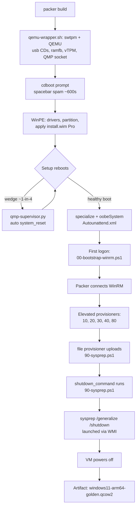

# packer-windows-arm64: Windows 11 ARM64 golden image

An educational, file-by-file walkthrough of a Packer build that produces a
Sysprep-generalized Windows 11 ARM64 "golden image" QCOW2 on QEMU/KVM
(Asahi / Apple Silicon aarch64 host). Written for engineers who have **not
used Packer before**: it explains what every file in this directory does,
what each block of code is for, and why it exists - including the failures
that forced each design decision (see the Troubleshooting Journey).

## What this produces

A Sysprep-generalized QCOW2 disk image, with validation evidence and
checksums - all generated from version-controlled code. The pipeline
demonstrates repeatability, policy-as-code, controlled-failure validation,
identity generalization (Sysprep), and release evidence.

## Packer in five minutes

Packer (HashiCorp) builds machine images - "golden images" - from one
declarative config file. You describe the VM, the installer, and the
post-install configuration; Packer boots the VM in a hypervisor, installs
the OS unattended, runs your scripts inside it, and writes out a disk
image. The same config produces the same image every time, on any machine
that has the inputs.

The three concepts you need before reading the config:

1. **Source / builder** - the `source` block defines the VM: which
   hypervisor (QEMU here), which ISO to install from, CPU/RAM/disk, and
   how Packer will reach the installed OS. It never contains provisioning
   logic.
2. **Communicator** - once the OS is installing, Packer needs a way to run
   commands inside the guest. For Windows that is **WinRM** (HTTP/SOAP on
   port 5985). Everything Packer does after install happens through it.
3. **Provisioner** - `build`-block steps that run inside the guest through
   the communicator: PowerShell scripts, file uploads, etc.

A Packer template is HCL with exactly three top-level block types:

```hcl
packer {
  required_version = ">= 1.10.0"          # version floor
  required_plugins { qemu = { ... } }     # pinned builder plugin
}

source "qemu" "windows11_arm64" {
  # The VM definition: ISO, CPU, disk, firmware, communicator
}

build {
  sources      = ["source.qemu.windows11_arm64"]  # reference to the source
  # Provisioners: what to run inside the guest, in order
}
```

The command lifecycle mirrors that: `packer init` (download the pinned
plugins) -> `packer fmt` (canonical formatting) -> `packer validate`
(parse + sanity-check) -> `packer build` (the real thing).

Two Windows-specific terms used throughout:

- **Golden image** - a preinstalled, preconfigured template that
  deployments clone instead of installing from scratch.
- **Sysprep /generalize** - Microsoft's tool that strips machine-specific
  identity (SIDs, hardware-specific state) from an installed Windows so
  the image can be cloned safely. It is the last thing this build runs.

## The build, start to finish

What actually happens when you type `packer build .`:

1. Packer generates a QEMU command line and executes it - but
   `qemu_binary` points at `scripts/qemu-wrapper.sh`, which rewrites the
   arguments (USB CDs, input devices, ramfb display, vTPM) and launches
   the real `qemu-system-aarch64` with `swtpm` for TPM 2.0.
2. The VM boots the Windows setup ISO. Firmware shows "Press any key to
   boot from CD or DVD" at a nondeterministic moment, so Packer's
   `boot_command` spams the spacebar every 2 seconds for ~600 seconds
   over VNC.
3. WinPE loads the ARM64 VirtIO drivers from the unattend CD (so it can
   see the virtio disk), partitions the disk (EFI + MSR + C:), and
   applies `install.wim` image index 3 (Windows 11 Pro).
4. Setup reboots several times. On this KVM/ARM64 host roughly 1 boot in
   4 wedges at firmware - `scripts/qmp-supervisor.py` (running alongside)
   detects it and auto-issues a QEMU `system_reset`.
5. The `Autounattend.xml` answer file carries the install through the
   `specialize` and `oobeSystem` passes: computer name, OOBE bypasses,
   the local `packer` admin account, one autologon.
6. At first logon, the answer file runs `scripts/00-bootstrap-winrm.ps1`
   from the unattend CD: WinRM comes up on 5985 with the firewall off.
7. Packer connects over WinRM and runs the provisioning pipeline as an
   elevated scheduled task: `10` software (winget), `20` policies,
   `30` features, `40` validation gate, `80` cleanup.
8. Packer uploads `scripts/90-sysprep.ps1` (file provisioner), then the
   `shutdown_command` runs it: sysprep `/generalize /shutdown`, launched
   via WMI so nothing can kill it mid-flight. The VM powers off.
9. Packer finalizes the artifact:
   `output/windows11-arm64-<version>/windows11-arm64-golden.qcow2`.



## Directory layout

```
packer-windows-arm64/
├── windows11-arm64.pkr.hcl              # Packer build config (source + build)
├── variables.pkr.hcl                    # Variable declarations (types, defaults)
├── windows11-arm64.auto.pkrvars.hcl     # Variable VALUES (gitignored - password)
├── answer-files/
│   └── Autounattend.xml                 # Windows answer file (HCL-templated)
├── drivers/                             # ARM64 VirtIO drivers for the unattend CD
│   ├── viostor/                         #   block-device (disk) driver
│   └── NetKVM/                          #   network (NIC) driver
├── assets/
│   └── software/                        # Legacy bundled installers (gitignored, unused)
├── reports/                             # Placeholder for validation evidence
├── scripts/                             # Everything executable (see below)
└── output/                              # Build artifacts (gitignored)
```

Quick reference - every executable file, where it runs, and who invokes it:

| File | Runs on | Invoked by | One-line purpose |
|---|---|---|---|
| `scripts/qemu-wrapper.sh` | Linux host | Packer (`qemu_binary`) | Rewrites QEMU args for ARM virt; starts swtpm |
| `scripts/pdeathsig-exec.py` | Linux host | qemu-wrapper.sh | Kernel-kills QEMU/swtpm if the wrapper dies |
| `scripts/qmp-supervisor.py` | Linux host | You, beside the build | Auto-detect and reset wedged boots via QMP |
| `scripts/00-bootstrap-winrm.ps1` | Windows guest | Autounattend FirstLogonCommands | Bring WinRM up at first logon |
| `scripts/10-install-software.ps1` | Windows guest | Packer provisioner | Install software via winget |
| `scripts/20-apply-policies.ps1` | Windows guest | Packer provisioner | Security policy as code |
| `scripts/30-enable-features.ps1` | Windows guest | Packer provisioner | OpenSSH, RDP, Defender, log sizes |
| `scripts/40-validate-image.ps1` | Windows guest | Packer provisioner | Validation gate - throws on failure |
| `scripts/80-cleanup.ps1` | Windows guest | Packer provisioner | Temp wipe + pre-sysprep free-space gate |
| `scripts/90-sysprep.ps1` | Windows guest | `shutdown_command` | Launch Sysprep via WMI, detached |

The numeric prefixes are the pipeline order; the split matters:
`00` runs from the unattend file at first logon (before Packer has any
connection), `10`-`80` run via the WinRM provisioner, and `90` is uploaded
separately and invoked by the `shutdown_command` at teardown.

## Configuration files

### `windows11-arm64.pkr.hcl` - the build config

The main Packer template. Packer loads every `*.pkr.hcl` file in the
directory; this one holds the `packer`, `source`, and `build` blocks.

**`packer` block - version floor and plugin pinning**

```hcl
packer {
  required_version = ">= 1.10.0"
  required_plugins {
    qemu = { source = "github.com/hashicorp/qemu", version = "~> 1.1" }
  }
}
```

Since Packer 1.7 the builders live in plugins. `packer init .` downloads
the QEMU builder plugin at the pinned version. Why it matters: anyone
checking out this repo builds with the same builder behavior - builds are
reproducible by construction, not by luck.

**Source block - the VM definition**

`source "qemu" "windows11_arm64"` defines the machine. The label becomes
the reference `source.qemu.windows11_arm64` used in the build block.

*Installer media and checksum*

```hcl
iso_url      = var.windows_iso_path
iso_checksum = var.windows_iso_checksum
```

The Windows 11 ARM64 ISO to boot from. The `sha256:` checksum makes Packer
refuse the build if the media is wrong - reproducibility starts with
verified inputs.

*Artifact naming*

```hcl
output_directory = "output/windows11-arm64-${var.image_version}"
vm_name          = "windows11-arm64-golden.qcow2"
```

Where the finished disk lands and what it is called. Versioned by
`image_version`, so successive builds never overwrite each other.

*The QEMU wrapper - the central workaround in this project*

```hcl
qemu_binary = "scripts/qemu-wrapper.sh"
```

Packer's QEMU plugin supports `qemuargs` for extra arguments - but they
**replace** the entire auto-generated command line, so you end up
hand-maintaining every argument Packer normally writes. Instead this
project points `qemu_binary` at a wrapper script: Packer invokes it as if
it were qemu itself, and the wrapper forwards every argument with
surgical edits, appending its own devices. See `scripts/qemu-wrapper.sh`
below for what it changes and why (USB CD topology, input devices,
ramfb, ARM vTPM).

*Machine, acceleration, sizing*

```hcl
machine_type = "virt"
accelerator  = "kvm"
cpu_model    = "host"
cpus         = var.cpus       # default 6
memory       = var.memory     # default 8192 MB
disk_size    = var.disk_size  # default 80G
format       = "qcow2"
headless     = var.headless
```

`virt` is QEMU's ARM reference platform; `kvm` + `cpu_model = "host"` give
near-native speed on this aarch64 host. `qcow2` is the sparse, resizable
disk format. `headless = true` runs with no GUI window (Packer still uses
VNC internally for keystroke injection).

*The communicator*

```hcl
communicator   = "winrm"
winrm_username = var.winrm_username
winrm_password = var.winrm_password
winrm_timeout  = "3h"
winrm_port     = 5985
```

How Packer talks to the guest after install. The credentials are the
local admin account the unattend file creates. The 3-hour timeout exists
because an emulated-ARM Windows install is slow, and Packer's default
would give up mid-install.

*VirtIO devices*

```hcl
disk_interface = "virtio"
net_device     = "virtio-net"
```

Paravirtual disk and NIC - much faster than emulated hardware, but the
Windows ISO has no in-box drivers for them, which is why the `drivers/`
tree exists and gets loaded during WinPE (see below).

*EFI firmware and the vTPM subtlety*

```hcl
efi_boot          = true
efi_firmware_code = "/usr/share/edk2/aarch64/QEMU_EFI-qemuvars-pflash.raw"
efi_firmware_vars = "/usr/share/edk2/aarch64/vars-template-pflash.raw"
vtpm              = false
```

Windows 11 boots only via UEFI and its setup enforces TPM 2.0. The
`qemuvars` firmware variant supports Secure Boot variable storage
(attached by the wrapper as `uefi-vars-sysbus`). `vtpm = false` looks
wrong but is deliberate: Packer's own `vtpm` option hardcodes the x86
`tpm-tis` device, which is invalid on ARM. The ARM TPM 2.0 device
(`tpm-tis-device` backed by a real `swtpm`) is added by the wrapper
instead, so Windows 11's hardware check passes natively.

*The supplemental "unattend CD"*

```hcl
cd_content = {
  "Autounattend.xml"       = templatefile("answer-files/Autounattend.xml", {...})
  "00-bootstrap-winrm.ps1" = file("scripts/00-bootstrap-winrm.ps1")
  "image-version.txt"      = var.image_version
}
cd_files = ["./drivers"]
cd_label = "UNATTEND"
```

`cd_content` builds files into an extra ISO at build time - that is how
the answer file gets into the VM. `templatefile()` renders
`Autounattend.xml` with the WinRM username/password and the edition
index, so the secret never needs to be committed (it comes from the
gitignored pkrvars file). `cd_files` bundles the ARM64 VirtIO driver tree
onto the same CD - the `./` prefix preserves the `drivers/` directory
structure that the answer file's `DriverPaths` reference. `cd_label`
names the volume `UNATTEND` so scripts can identify it.

*Shutdown configuration*

```hcl
shutdown_timeout = "60m"
shutdown_command = "powershell.exe -ExecutionPolicy Bypass -File C:\\Windows\\Temp\\90-sysprep.ps1"
```

`shutdown_command` is the last command Packer runs in the guest; it
invokes the uploaded `90-sysprep.ps1`, which starts Sysprep with
`/shutdown`. `shutdown_timeout` is how long Packer waits for the VM to
actually power off - one hour, because `/generalize` on emulated ARM64
can legitimately take half an hour, and a timed-out build is a failed
build.

*Boot keystrokes*

```hcl
boot_wait = "3s"
boot_command = ["<spacebar><wait2s><spacebar><wait2s>...", ...]
```

`boot_command` types keys into the VM's VNC console before the OS exists.
Its only job here is answering the cdboot "Press any key to boot from CD
or DVD" prompt - which arrives nondeterministically (observed ~5 s to
200+ s; fresh-swtpm TPM2 keygen stretches firmware POST). The template
sends a spacebar every 2 seconds for ~600 seconds so the prompt is always
answered, even across cdboot timeout-reset cycles. Stray presses during
setup are harmless (no focused controls at that stage).

**Build block - what runs inside the guest**

```hcl
build {
  name    = "windows11-arm64-golden"
  sources = ["source.qemu.windows11_arm64"]
```

Names the build and wires it to the source above.

*The elevated PowerShell provisioner*

```hcl
provisioner "powershell" {
  elevated_user     = var.winrm_username
  elevated_password = var.winrm_password
  environment_vars  = ["IMAGE_VERSION=${var.image_version}"]
  scripts = [
    "scripts/10-install-software.ps1",
    "scripts/20-apply-policies.ps1",
    "scripts/30-enable-features.ps1",
    "scripts/40-validate-image.ps1",
    "scripts/80-cleanup.ps1"
  ]
}
```

Scripts run in the listed order, one after another, over WinRM.
`elevated_user`/`elevated_password` make Packer run each script via a
**scheduled task with a full elevation token** instead of directly in
the WinRM session. That is not optional polish: DISM servicing operations
(`Add-WindowsCapability` in `30-enable-features.ps1`) fail with "Access
is denied" from the WinRM session's network-logon token even though it
is an admin token - the CBS/servicing stack rejects that session type.
`environment_vars` injects the image version where scripts can read it.

*The file provisioner*

```hcl
provisioner "file" {
  source      = "scripts/90-sysprep.ps1"
  destination = "C:/Windows/Temp/90-sysprep.ps1"
}
```

Uploads the sysprep script to a known path so the one-line
`shutdown_command` can invoke it. Ordering note: this runs **after** the
powershell provisioner (i.e. after `80-cleanup.ps1`'s temp wipe), so the
cleanup cannot delete it.

### `variables.pkr.hcl` - variable declarations

Declares every input with a type, description, and default. Values are
supplied separately (see the pkrvars file below), which is what lets the
secret-bearing file stay out of git.

| Variable | Type | Default | Purpose |
|---|---|---|---|
| `windows_iso_path` | string | - | Path to the Windows 11 ARM64 ISO |
| `windows_iso_checksum` | string | - | `sha256:` checksum of that ISO |
| `virtio_iso_path` | string | - | Path to the virtio-win driver ISO |
| `virtio_iso_checksum` | string | - | `sha256:` checksum of that ISO |
| `image_version` | string | `1.0.0` | Semver stamped into the output dir + `image-version.txt` |
| `edition_index` | number | `3` | `install.wim` image index: 1=Home, 2=Home SL, 3=Pro |
| `winrm_username` | string | `packer` | Local admin account Packer uses |
| `winrm_password` | string | - | Password for that account (must meet Windows complexity) |
| `headless` | bool | `false` | `true` = QEMU with no GUI |
| `cpus` / `memory` / `disk_size` | - | 6 / 8192 / `80G` | VM sizing |

Details worth teaching:

- `winrm_password` is declared `sensitive = true` - Packer redacts it
  from logs and UI output.
- `edition_index = 3` is how the unattend file selects Windows 11 **Pro**
  out of the multi-edition `install.wim`.
- Caveat: `virtio_iso_path`/`virtio_iso_checksum` are currently
  **declared but unused** - the QEMU wrapper hardcodes the virtio-win ISO
  path instead. Either wire them through or remove them when next
  refactoring.

### `windows11-arm64.auto.pkrvars.hcl` - variable values

Packer auto-loads any `*.auto.pkrvars.hcl` in the build directory. This
file holds the actual values: the two ISO paths and checksums, and the
WinRM password. It is **gitignored** (`.gitignore` excludes
`*.auto.pkrvars.hcl` precisely because such files usually hold secrets);
each engineer creates it locally. If it is missing, `packer validate`
fails immediately with a list of unset variables - by design.

### `answer-files/Autounattend.xml` - the Windows answer file

Windows Setup consumes "unattend" (answer) XML files to run without any
human at the console. This file is rendered by `templatefile()` at build
time, so `${winrm_username}`, `${winrm_password}` and
`${edition_index}` are HCL substitutions into the XML - the same values
Packer will later use to connect. It ships on the `UNATTEND` CD.

An answer file is organized into **passes** - phases of setup, each with
its own components. This one uses three:

**Pass `windowsPE`** (setup, before the disk exists)

- `Microsoft-Windows-International-Core-WinPE` - locks all locale
  settings to `en-US`, eliminating language screens.
- `Microsoft-Windows-Setup` / `DiskConfiguration` - wipes disk 0 and
  creates the modern GPT layout Windows 11 requires: a 100 MB EFI
  partition (FAT32, `System`), a 128 MB MSR partition, and the rest as
  one NTFS `C:` (`Extend=true` fills the disk). `ModifyPartitions`
  formats and letters them.
- `Microsoft-Windows-Setup` / `ImageInstall` - which image to install
  and where: `install.wim` at `/IMAGE/INDEX` `${edition_index}` (Pro),
  onto disk 0, partition 3.
- `Microsoft-Windows-Setup` / `UserData` - accepts the EULA and supplies
  the well-known **generic Windows 11 Pro setup key**
  (`VK7JG-NPHTM-C97JM-9MPGT-3V66T`). This is a publicly documented
  placeholder key that only selects the edition; it does not activate
  anything.
- `Microsoft-Windows-Deployment` / `RunSynchronous` - the `LabConfig`
  registry bypasses (TPM, Secure Boot, RAM, storage, CPU checks) written
  as a **safety net**. Crucial ordering lesson: Windows 11's hardware
  check fires *before* these commands run, so LabConfig alone cannot
  pass TPM - that is why the wrapper attaches a real vTPM instead.
- `Microsoft-Windows-PnpCustomizationsWinPE` / `DriverPaths` - loads the
  VirtIO drivers into WinPE so setup can see the virtio disk and NIC.
  The paths are listed for letters `D:` through `I:` because the unattend
  CD's drive letter is nondeterministic at this stage. Without viostor,
  setup finds no disk; without NetKVM, first-boot networking is dead.

**Pass `specialize`** (after image apply, before first boot UI)

- `Microsoft-Windows-Shell-Setup` - sets `ComputerName` to
  `WIN-GOLDEN` (Sysprep regenerates identity later anyway).
- `Microsoft-Windows-Deployment` - writes `BypassNRO` so OOBE does not
  demand a network connection. The inline comment is a recorded lesson:
  do **not** enable WinRM in this pass - an earlier attempt crashed
  setup into the "computer restarted unexpectedly" reboot loop while
  devices were still installing. WinRM belongs at first logon, when PnP
  and the network stack have settled.

**Pass `oobeSystem`** (first-boot experience)

- `Microsoft-Windows-International-Core` - locale again, for the full OS.
- `Microsoft-Windows-Shell-Setup` / `OOBE` - hides every interactive
  screen (EULA, local-account, OEM registration, online account,
  wireless setup) so first boot needs no human.
- `UserAccounts` / `LocalAccounts` - creates the `packer`
  (`${winrm_username}`) local account, Administrators group, with
  `${winrm_password}` as a plaintext password.
- `AutoLogon` - logs that account in exactly once (`LogonCount = 1`) so
  the next section can run unattended.
- `FirstLogonCommands` - a single PowerShell one-liner that retry-scans
  drive letters `C:`-`I:` every 2 s for up to 90 s looking for
  `00-bootstrap-winrm.ps1` on the unattend CD, then runs it. The retry
  loop is a hard-won fix: USB CD-ROM drive letters lag first logon by
  seconds, and the original one-shot scan silently found nothing -
  leaving WinRM permanently down and the build hung.

## Supporting directories

### `drivers/` - ARM64 VirtIO drivers

Extracted from the virtio-win ISO, pre-filtered to the ARM64 build.
Windows has no in-box virtio support, and this VM's disk and NIC are
both virtio (`disk_interface = "virtio"`, `net_device = "virtio-net"`).

- `viostor/` - the **block driver** (the disk). Without it, Windows Setup
  sees no install target.
- `NetKVM/` - the **network driver** (the NIC). Without it, first boot
  has no networking.

File roles inside each folder:

| Extension | Role |
|---|---|
| `.inf` | The driver manifest Windows installs from |
| `.sys` | The kernel-mode driver binary itself |
| `.cat` | Signed catalog proving the package is untampered |
| `netkvmco.exe`, `netkvmp.exe` | NetKVM co-installer + control panel helper |

They are bundled onto the `UNATTEND` CD by `cd_files` and loaded at two
points: during WinPE via `PnpCustomizationsWinPE` (so setup sees the
disk at all), and best-effort at first logon via `pnputil` in
`00-bootstrap-winrm.ps1` (so the *installed* OS has them too).

### `assets/software/` - legacy bundled installers (unused)

Native-ARM64 installers (7-Zip `.exe`, PowerShell 7 `.msi`) from the
original "upload installers over WinRM" approach. WinRM's SOAP file
transfer moved ~100 MB at ~30 KB/s - over an hour - so the build moved
to winget (see `10-install-software.ps1`). The folder is gitignored and
kept only as a reference for what "native ARM64 installer" looked like;
nothing in the build reads it.

### `reports/` - validation evidence (placeholder)

Currently empty. Intended home for build validation evidence pulled out
of the image (the in-guest gate writes
`C:\ImageBuild\validation-report.json` - see `40-validate-image.ps1`).

### `output/` - build artifacts (gitignored)

Where Packer writes the finished image:
`output/windows11-arm64-<version>/windows11-arm64-golden.qcow2`. The same
directory also collects `efivars.fd` - the EFI variable store (pflash)
snapshot, which contains machine-specific firmware state (including
Secure Boot keys) and is **not** part of the distributable artifact; you
ship the QCOW2. Gitignored so multi-gigabyte disks can never be
committed.

## scripts/ walkthrough

### Host-side scripts (run on the Linux build machine)

#### `scripts/qemu-wrapper.sh` - the fake qemu binary

The linchpin of the ARM64 support. Packer runs it as `qemu_binary`; it
behaves like `qemu-system-aarch64` with Packer's arguments, plus fixes.
Block by block:

1. **Header + `set -euo pipefail`** - documents why a wrapper instead of
   `qemuargs` (replacement, not append - see above) and enables strict
   bash (fail on error, undefined variable, or a failing pipe stage).
2. **swtpm startup** - creates a temp dir, starts `swtpm socket --tpm2`
   in the background under `pdeathsig-exec.py`. Two deliberate choices:
   swtpm runs *without* `--daemon` (the daemonizing fork would clear
   PDEATHSIG protection), and it is PDEATHSIG-wrapped so it can never be
   orphaned.
3. **Socket readiness wait** - polls up to 2 s for the swtpm control
   socket, then fails loudly if it never appears. Fail fast beats a QEMU
   that can't find its TPM.
4. **`cleanup()` / `on_exit()` / `trap EXIT TERM INT`** - belt-and-braces
   teardown: kill QEMU, kill swtpm, remove the temp dir. The *real*
   guarantee is PDEATHSIG (next script); traps alone leaked processes
   when Packer's teardown killed the wrapper with an untrappable signal.
5. **The argument-rewrite loop** - walks Packer's argv looking for
   `-drive ... media=cdrom`. For each hit it strips the `if=` and
   `index=` keys (they would conflict with manual `-device`
   attachment), re-tags the drive, and queues a matching
   `usb-storage` device. Bus assignment is the subtle part: the first
   CD (the Windows setup ISO) stays on `usb.0` beside the input devices;
   every later CD goes to the second controller `usb2.0` - on a single
   bus, a 5th device makes QEMU silently insert a 12 Mb/s full-speed
   hub, and slow enumeration pushes the cdboot prompt past Packer's
   keystroke window, regressing the boot to PXE.
6. **`bus_extras`** - the added devices, in an order where buses exist
   before their devices:
   - `qemu-xhci` x2 - the two USB controllers (`usb`, `usb2`).
   - `usb-kbd` + `usb-tablet` - input devices; without them Packer's
     VNC keystrokes go nowhere.
   - `ramfb` - a framebuffer; ARM `virt` ships no graphics card, and
     without ramfb the display is just the QEMU monitor.
   - `uefi-vars-sysbus` - the Secure Boot variable-store device the
     qemuvars firmware requires.
   - `chardev` + `tpmdev` + `tpm-tis-device` - a real TPM 2.0 backed by
     the swtpm socket, using the **ARM** TIS device variant.
   - `-serial file:...` - firmware/WinPE serial console to
     `/tmp/packer-serial.log` for diagnosis.
   - `-qmp unix:...` - the QMP control socket the supervisor uses.
7. **`final_argv`** - rewritten Packer args + bus extras + CD devices +
   the virtio-win ISO attached as one more usb-storage CD on `usb2.0`
   (full driver set with co-installers, for manual use). Caveat: this
   path is **hardcoded** to this checkout - change it if you move the
   repo (see Caveats).
8. **Invocation logging** - writes the complete final command line to
   `/tmp/qemu-wrapper.cmd.log` so you can see exactly what QEMU ran.
9. **Launch + `wait`** - starts QEMU in the background under
   `pdeathsig-exec.py`, waits for it, and propagates its exit code. The
   background-and-wait shape lets the traps coexist with PDEATHSIG
   teardown.

#### `scripts/pdeathsig-exec.py` - guaranteed child teardown

Thirty lines that solve "Packer killed the wrapper, and the wrapper's
children kept running for hours." The Linux `prctl(PR_SET_PDEATHSIG)`
facility tells the kernel: *when my parent dies, for any reason, send me
this signal*. The script:

1. Calls `prctl(PR_SET_PDEATHSIG, SIGKILL)` via `ctypes` - no
   third-party deps, just libc.
2. `os.execvp()` **replaces itself** with the target command - the
   prctl setting survives `execve`, so qemu/swtpm keep the protection.

Why traps weren't enough: bash's `EXIT` trap never runs on `SIGKILL`, and
Packer's build teardown kills the wrapper precisely that way - which
orphaned QEMU and swtpm (observed 2026-09-29/30: a leaked VM outlived its
errored build for hours). PDEATHSIG works *however* the parent dies,
including SIGKILL. One rule it enforces on callers: never start the
child with `--daemon`, because the daemonizing fork clears the
parent-death signal - hence swtpm running in the background instead.

#### `scripts/qmp-supervisor.py` - the boot-wedge auto-healer

A standalone watcher you run alongside the build. It exists because of
a host-level KVM/ARM64 race: after a guest reboot, the boot chain
occasionally spins forever right after firmware starts `bootmgfw.efi` -
display frozen on the firmware console, two vCPUs busy-polling, build
disk silent - roughly 1 reboot in 4. A QMP `system_reset` re-enters the
boot and usually lands a healthy boot. This script automates that lever.

Constants: watch socket `/tmp/packer-qmp.sock`; screendump interval
default 15 s; `STATIC_THRESHOLD = 6` consecutive identical dumps (~90 s);
`DISK_IDLE_THRESHOLD = 90` s; `MAX_RESETS = 3` per `RESET_WINDOW = 3600`
s (so a genuinely broken boot cannot reset-loop forever).

- `connect()` - waits up to 5 minutes for the QMP socket (so you can
  start the supervisor *before* `packer build`), then performs the QMP
  handshake (greeting + `qmp_capabilities`).
- `qmp()` - sends a JSON command and collects the response.
- `parse_ppm()` - a minimal P6-PPM parser: pulls width/height/raw RGB
  out of QEMU's screendump format.
- `firmware_text_signature()` - classifies a screen as "firmware text
  console": black-dominant (>= 90% pure black) with <= 200 distinct
  colors. Windows boot/setup screens are animated and/or blue, so they
  never match - this is the false-positive filter.
- `ppm2png()` - a hand-rolled PNG encoder (IHDR/IDAT/IEND + zlib, no
  Pillow) converting dumps to PNG so a human can eyeball what the VM was
  showing.
- `main()` loop:
  1. `--reset` gives you a manual one-shot reset lever.
  2. Every interval: QMP `screendump`, SHA-256 the raw PPM, and track how
     many consecutive dumps were byte-identical (a "static" screen).
     The signature check runs on the raw PPM - a recorded bug had it
     parsing the converted PNG instead, where it always returned False
     and the detector silently never fired.
  3. **Arming**: the detector only arms after the first write to the
     build disk. Early boot (firmware POST, the cdboot prompt) is
     legitimately static with an untouched disk - and the prompt screen
     looks pixel-identical to the wedge. The wedge only ever happens at
     a *reboot*, by which point install has written gigabytes.
  4. **Wedge = armed + static >= threshold + firmware-text screen +
     disk idle >= 90 s** -> `system_reset`, logged, bounded to 3/hour.
  5. Keeps the last ~80 PNGs, prunes older ones.

### Guest-side scripts (run inside Windows)

#### `scripts/00-bootstrap-winrm.ps1` - first logon, WinRM up

Runs from the unattend CD via `FirstLogonCommands` - before Packer has
any connection to the VM. Its whole purpose: make port 5985 answer.

- `$ErrorActionPreference = 'Stop'` - any failure should be loud.
- `Set-NetConnectionProfile ... -NetworkCategory Private` - QEMU's
  slirp NIC registers as unidentified/Public, and WinRM cmdlets balk on
  Public; flip the profile first.
- `Enable-PSRemoting -Force -SkipNetworkProfileCheck` - creates the
  WinRM listener; the flag is required precisely because of the Public
  profile above.
- `netsh advfirewall set allprofiles state off` - build-only choice:
  guarantee nothing blocks 5985. Acceptable because this firewall state
  is part of a throwaway *build* VM (see Caveats for the image-side
  consideration).
- `WSMan:` settings - `AllowUnencrypted` + `Basic` auth in both
  directions, matching Packer's default Windows transport (HTTP + basic).
- `winrm set ... MaxTimeoutms=1800000` - 30-minute operation timeout so
  slow ARM provisioning doesn't time out.
- `sc.exe config WinRM start= auto` + `Restart-Service` - persistent and
  immediate.
- **Best-effort driver install** - waits up to 90 s for a `drivers\`
  folder to appear on letters `D:`-`I:` (same drive-letter race as the
  answer file), then `pnputil /add-driver` every `.inf`. Deliberately
  non-fatal: WinPE already staged the drivers via `DriverPaths`, so a
  missed scan must not break the bootstrap.

Encoding lesson baked into this file: everything a Windows guest will
parse must be **pure ASCII**. Packer writes scripts as UTF-8 without
BOM; PowerShell 5.1 parses BOM-less files as CP1252, where a single
em-dash breaks the parser silently (observed 2026-09-29 - WinRM stayed
down with no visible error).

#### `scripts/10-install-software.ps1` - winget installs

The software stage, and the template's extension point for new packages.

- `Test-Winget` helper - `winget` may not be on `PATH` yet; check both
  the command and the known WindowsApps location.
- **The 10-minute wait** - on an unattended image, Windows provisions
  Store apps (including App Installer, which *is* winget)
  asynchronously after first logon. Checking immediately fails
  (observed 2026-09-29: "winget not found").
- **The bootstrap fallback** - if winget still isn't there after 10
  minutes, download the pinned winget-cli release (v1.29.290): the
  multi-arch `.msixbundle`, the ARM64 dependency `.appx` files from the
  dependencies zip, and the offline `License1.xml`. Then two installs:
  `Add-AppxPackage` for the current user (so *this build* can use winget
  now) and `Add-AppxProvisionedPackage -Online` with the license (so
  *users of the golden image* get winget at their first logon).
- `PATH` append, then a hard `throw` if winget is still missing - fail
  the build rather than ship an image without its package manager.
- **The package list** - `Git.Git`, `7zip.7zip`. To add software, add
  its exact ID from the winget catalog here.
- **The install loop** - `winget install --id <id> --exact --silent
  --accept-package-agreements --accept-source-agreements` per package;
  exit code `0` or `3010` (success, reboot required) pass, anything else
  throws. A failed package fails the build - controlled failure beats
  a silently degraded image.

Why winget at all: it selects the **native ARM64 installer** from the
official manifest, and downloads over HTTPS in minutes - vs WinRM's
~30 KB/s uploads of bundled installers. (Chocolatey was tried first;
its released CLI lacks reliable ARM64 architecture selection.)

#### `scripts/20-apply-policies.ps1` - policy as code

Hardening that ships *inside* the image, reviewable in git:

- `Set-PolicyDword` helper - create the registry key if missing, then
  set a `DWORD` value. The whole file's engine.
- PowerShell **ScriptBlockLogging** and **ModuleLogging** - every
  script block/module execution lands in the event log (security
  telemetry).
- `ProcessCreationIncludeCmdLine_Enabled` - process-creation auditing
  *with command lines*.
- **Legal notice** - `LegalNoticeCaption`/`LegalNoticeText` as string
  (not DWORD) values: the logon banner identifying this as a managed
  pipeline-built system.
- `Disable-WindowsOptionalFeature SMB1Protocol` - removes SMBv1.
- `auditpol /set ... "Process Creation"` - enables the audit subcategory
  both ways (the registry value above only adds the command line to
  already-audited events).
- `Disable-LocalUser Guest` - no guest logon.
- `gpupdate /force` - apply immediately rather than at next GP refresh.

#### `scripts/30-enable-features.ps1` - capabilities and services

- **OpenSSH client + server** - capability-state check then
  `Add-WindowsCapability -Online`. This is the DISM call whose "Access
  is denied" failure is the entire reason the provisioner runs elevated
  (see the build block above) - worth reading twice.
- `Set-Service sshd -StartupType Automatic` + `Start-Service` - on at
  boot and now.
- **RDP** - `fDenyTSConnections = 0` enables it; the `netsh` rule opens
  the firewall group.
- **Defender** - `Set-MpPreference -DisableRealtimeMonitoring $false` -
  real-time protection explicitly on.
- **Event log sizing** - `wevtutil sl Security/System/Application
  /ms:524288` - 512 MB each, so a busy deployed system doesn't wrap its
  logs in days (default sizes do).

#### `scripts/40-validate-image.ps1` - the validation gate

Turns "looks about right" into a machine-checked assertion. Builds an
ordered hashtable of checks - Git present, 7-Zip present, OpenSSH Server
capability Installed, ScriptBlockLogging on, SMB1 disabled, Guest
disabled - plus timestamp/architecture metadata, and:

- writes it to `C:\ImageBuild\validation-report.json` - the evidence
  artifact that lives inside the image (what `reports/` is meant to
  collect);
- treats any check that isn't `$true` (excluding the metadata keys) as
  a hard failure: `throw 'Golden-image validation failed.'`

The gate order matters: it runs *before* cleanup and sysprep, so a
non-conforming image fails the build in minutes instead of producing a
polished artifact that's wrong inside.

#### `scripts/80-cleanup.ps1` - cleanup, minus the traps

`$ErrorActionPreference = 'SilentlyContinue'` - cleanup must never fail
a build over a locked temp file.

- Wipes `C:\Windows\Temp\*` **excluding `packer-*`** - Packer keeps its
  per-session env-var helper scripts there mid-pipeline; wiping them
  broke the next provisioner session (observed 2026-09-30).
- Wipes user temp.
- The big comment block is the education: three cleanup steps that were
  **removed** because each one stalled or destroyed the build on this
  hardware:
  - DISM `StartComponentCleanup` - 47+ minutes in the elevated context
    (vs ~10 non-elevated) with the guest idle;
  - Windows Update service stop - hung indefinitely;
  - free-space zeroing - filled the disk to 100%, starving sysprep and
    shutdown of scratch space (registry flushes, event logs, pagefile)
    until the build timed out.

  The theme: they were all *image-size optimizations*, never
  requirements - and compaction is done host-side anyway (the post-build
  `qemu-img convert` writes a compressed VMDK).
- **The free-space gate** - reports free GB and `throw`s below 2 GB.
  Sysprep needs scratch space; failing here takes seconds, while the
  same discovery at the shutdown timeout takes an hour.

#### `scripts/90-sysprep.ps1` - the finale

Uploaded by the file provisioner, invoked by `shutdown_command`. The
build's last guest-side act, and the file with the most recorded
failure modes:

- Locates `Sysprep.exe`, throws if absent.
- **Free-space gate** - same 2 GB rule as cleanup, checked again because
  provisioning since then may have consumed space.
- **Removes the per-user `Microsoft.Winget.Source*` appx package** -
  Sysprep's generalize validation (`AppxSysprep.dll`) requires *every*
  appx package to be provisioned machine-wide; the winget source
  package is per-user, and sysprep exits instantly with `0x80073cf2`
  because of it. (Diagnosed by pulling `setuperr.log` out of the
  running guest over WinRM while sysprep was failing.) Deployed images
  re-add winget sources on first use.
- **Launches Sysprep via `Invoke-CimMethod Win32_Process.Create`** with
  `/oobe /generalize /shutdown /quiet`. The in-file history explains
  why WMI and nothing else: three previous launch methods all died -
  `Start-Process -Wait` (WinRM drops mid-shutdown; Packer sees EOF and
  errors), plain `Start-Process` (killed instantly by scheduled-task
  cleanup), `-PassThru` + 10 s sleep (killed mid-generalize after
  writing 57 KB of Panther logs). WMI creates the process in the WMI
  service's own SYSTEM process tree - no scheduled-task cleanup can
  reach it.
- Checks `ReturnValue`, prints the PID, and exits - the script returns
  immediately; Sysprep finishes asynchronously and the `/shutdown` flag
  powers the VM off, which is the signal Packer has been waiting for
  (`shutdown_timeout` covers the gap).

## Running the build

Prerequisites on the build host:

- Packer >= 1.10
- `qemu-system-aarch64` with KVM available (i.e. an aarch64 host - this
  build runs on Asahi Linux / Apple Silicon)
- `swtpm` (software TPM 2.0)
- EDK2 aarch64 firmware at the two pflash paths hardcoded in
  `windows11-arm64.pkr.hcl` (from the `edk2-aarch64` package on Arch)
- Python 3 (stdlib only - the supervisor and PDEATHSIG helper have no
  dependencies)
- The Windows 11 ARM64 ISO and virtio-win ISO in `../files/` (gitignored
  - see the repo-root README), plus checksums
- A local `windows11-arm64.auto.pkrvars.hcl` with the values

```bash
cd packer/packer-windows-arm64
packer init .                 # download the pinned QEMU plugin
packer fmt -recursive .       # canonical HCL formatting
packer validate .             # parse + sanity-check the template

# Launch with the auto-healing supervisor (it waits up to 5 min for the
# QMP socket, so either order works):
python3 scripts/qmp-supervisor.py &
packer build .

# Or fully headless:
packer build -var headless=true .
```

If a build errors or you cancel it, teardown is guaranteed by PDEATHSIG:
no orphaned QEMU or swtpm should survive. If one somehow does,
`pkill -f qemu-system-aarch64` / `pkill swtpm` cleans up.

## Post-build

```bash
qemu-img info output/windows11-arm64-1.0.0/windows11-arm64-golden.qcow2
qemu-img check output/windows11-arm64-1.0.0/windows11-arm64-golden.qcow2

qemu-img convert -p -f qcow2 -O vmdk -o subformat=streamOptimized \
  output/windows11-arm64-1.0.0/windows11-arm64-golden.qcow2 \
  output/windows11-arm64-1.0.0/windows11-arm64-golden.vmdk

cd output/windows11-arm64-1.0.0
sha256sum windows11-arm64-golden.qcow2 windows11-arm64-golden.vmdk > SHA256SUMS
```

The VMDK is a **VMware-format candidate**, not a production template
(ESXi-Arm doesn't support W11 ARM guest customisation).

## Caveats and future work

Honest limitations worth knowing before you extend this:

- The virtio-win ISO path is **hardcoded** inside `qemu-wrapper.sh`
  (an absolute path into this checkout). Moving the repo breaks it;
  the declared-but-unused `virtio_iso_path` variable is the natural fix.
- The local `packer` account created by the unattend file, the WinRM
  listener with Basic/unencrypted auth, and the disabled firewall all
  **persist into the golden image** - Sysprep doesn't remove them.
  Fine for a lab/eval image; for anything wider, plan post-deploy
  hardening (rename/disable the build account, re-enable the firewall,
  tighten WinRM) or add those steps before `90-sysprep.ps1`.
- `reports/` is an empty placeholder - nothing currently copies the
  in-guest validation report out of the image.
- `assets/software/` is dead weight from the pre-winget era.

## Troubleshooting Journey

Every architectural choice in this repository exists because a specific
failure was encountered on this hardware. This is the complete record,
in the order the issues were discovered and fixed.

### Phase 1: Boot and USB topology

**1. PXE boot regression (USB hub slowdown)**
- Symptom: VM booted to PXE instead of the Windows installer.
- Root cause: Attaching a 5th USB device (virtio-win ISO) on `bus=usb.0`
  made QEMU silently auto-insert a 12 Mb/s full-speed hub. The slow
  enumeration pushed the cdboot prompt past Packer's 60s key window.
- Fix: A second `qemu-xhci` controller (`usb2`). Setup ISO keeps usb.0;
  extra CDs go to usb2.0's fast root ports.
- Commit: `7a08166`

**2. Nondeterministic cdboot prompt arrival**
- Symptom: Some runs missed the "Press any key" prompt even with the
  topology fix.
- Root cause: Fresh swtpm instance does TPM2 RSA keygen on first boot.
  On emulated ARM64, this stretches firmware POST from 5s to 200s+.
- Fix: Extended boot_command spam from 63s to 600s (300 keypresses).
- Commit: `d75a7ad`

**3. Boot-chain wedge (host-level KVM/ARM64 race)**
- Symptom: After a guest reboot, the firmware starts `bootmgfw.efi` and
  then the VM freezes - display stuck on the firmware console, 2 vCPUs
  spinning, disk silent. Hits ~1-in-4 reboots at random boundaries.
- Root cause: A host-level virtualization race (not an image problem).
  A QMP `system_reset` re-enters the boot and usually succeeds.
- Fix: `scripts/qmp-supervisor.py` - screendumps every 15s, detects the
  wedge (static firmware-text screen + no disk writes for 90s, armed only
  after the first disk write), auto-resets (max 3/hour).
- Commits: `c4e32a1`, `d75a7ad`, `d5a2ade`

### Phase 2: WinRM and provisioning

**4. WinRM bootstrap never ran (drive-letter race)**
- Symptom: Windows booted to desktop, but WinRM stayed stopped and the
  firewall stayed on.
- Root cause: FirstLogonCommands fired before USB CD-ROM drive letters
  were assigned. The one-shot `if exist` scan found nothing and silently
  did nothing.
- Fix: The FirstLogonCommands now retry-wait up to 90s for the unattend
  CD, then run `00-bootstrap-winrm.ps1`.
- Commit: `7a08166`

**5. Bootstrap script parse failure (encoding)**
- Symptom: The bootstrap script was found but never did anything - WinRM
  stayed stopped, firewall on.
- Root cause: Em-dash characters (U+2014) in the script's comments and
  strings. Packer writes the script to the unattend CD as UTF-8 without
  BOM; Windows PowerShell 5.1 parses BOM-less scripts as CP1252, where
  the em-dash's third byte (0x94) is a closing smart-quote that breaks
  the parser.
- Fix: All guest-executed files (.ps1 scripts, unattend XML) are pure
  ASCII. A `pwsh` parser validation script checks every guest file.
- Commits: `69a52cd`, `f51bf86` (enforcement)

**6. DISM "Access is denied" (elevated context required)**
- Symptom: `Add-WindowsCapability -Online` for OpenSSH failed with
  "Access is denied" in the WinRM session, despite the session being an
  admin token (MSI installs succeeded).
- Root cause: The CBS/servicing stack rejects the WinRM network-logon
  session type for DISM operations specifically.
- Fix: `elevated_user`/`elevated_password` on the powershell provisioner -
  Packer runs the scripts via a scheduled task with a full elevation
  token.
- Commit: `07b001e`

### Phase 3: Software installation strategy

**7. WinRM file upload too slow (~30 KB/s)**
- Symptom: Uploading bundled installers (7-Zip + PowerShell 7, ~113 MB)
  over WinRM-SOAP took over an hour.
- Fix: Switched to winget (network downloads in minutes). Chocolatey
  was tried first (commit `580dcf2`) but its released CLI lacks reliable
  ARM64 architecture selection - replaced with winget which selects the
  native ARM64 installer per package manifest (commit `751566b`).
- Commits: `580dcf2`, `751566b`

**8. winget not available on clean image**
- Symptom: winget (App Installer) not found in the WinRM session right
  after first logon.
- Root cause: Windows provisions Store apps (including App Installer)
  asynchronously after first logon; the provisioning session checked
  too early.
- Fix: `10-install-software.ps1` waits up to 10 minutes, then falls
  back to bootstrapping from the pinned winget-cli release (msixbundle
  + ARM64 dependencies + offline license) if still missing.
- Commit: `73e7dee`

### Phase 4: Cleanup and shutdown

**9. DISM StartComponentCleanup 47+ minute stall**
- Symptom: The DISM `/StartComponentCleanup /ResetBase` step hung the
  build at "Cleaning up temporary files..." while the guest sat idle
  in Task Manager.
- Root cause: In the elevated scheduled-task context on emulated ARM64,
  DISM ran for 47+ minutes (vs ~10 min in prior non-elevated runs).
- Fix: Removed DISM cleanup from the script. It is an image-size
  optimization, not a sysprep requirement. Host-side qemu-img convert
  handles image size.
- Commit: `966a1de`

**10. Windows Update service stop hang**
- Symptom: `Stop-Service -Force` on wuauserv hung indefinitely in the
  elevated context.
- Fix: Removed the Windows Update cache clearing and prefetch clearing
  from the cleanup script. All are size optimizations, not requirements.
- Commit: `f51bf86`

**11. Disk-full sysprep starvation (the zeroing trap)**
- Symptom: Sysprep ran but never completed; the guest reported 0% free
  disk. The build timed out waiting for shutdown.
- Root cause: The cleanup script zeroed free space (for qcow2 compaction)
  by writing a file until the disk was 100% full, then deleted it. But
  sysprep and Windows shutdown need filesystem write access (registry
  flushes, event logs, pagefile). With 0 bytes free, they hang.
- Fix: Removed disk zeroing entirely. Free-space is reported and gated
  (minimum 2GB) before sysprep handoff. Compaction is handled host-side
  by the qemu-img convert to VMDK streamOptimized (a compressed format).
- Commits: `98ac313`, `e31df3d`

**12. Packer env-vars helper deleted by cleanup**
- Symptom: A non-fatal "not recognized" error for
  `packer-ps-env-vars-*.ps1` after the cleanup script's temp wipe.
- Root cause: The cleanup script wiped `C:\Windows\Temp\*` which included
  Packer's own env-vars helpers for the next session.
- Fix: The temp wipe excludes `packer-*`.
- Commit: `98ac313`

### Phase 5: Sysprep

**13. Sysprep blocked by per-user winget source package (0x80073cf2)**
- Symptom: Sysprep exited immediately after starting. Panther setuperr.log
  showed: "Package Microsoft.Winget.Source was installed for a user, but
  not provisioned for all users ... halting sysprep execution."
- Root cause: SysprepGeneralizeValidate (AppxSysprep.dll) requires ALL
  appx packages to be provisioned machine-wide. The winget source package
  is installed per-user when winget runs during provisioning.
- Diagnosis method: WinRM SOAP over the forwarded port (pywinrm) pulled
  the Panther logs from `C:\Windows\System32\Sysprep\Panther\` while
  sysprep was running.
- Fix: `90-sysprep.ps1` removes the per-user
  `Microsoft.Winget.Source*` package before calling Sysprep.exe.
- Commit: `58ece45`

**14. Sysprep launch: three failed methods before WMI**
This was the hardest problem - each fix revealed the next failure layer:

| Attempt | Method | What happened |
|---|---|---|
| 1 | `Start-Process -Wait` | Sysprep completed, called the Windows shutdown API, the WinRM service stopped mid-response. Packer saw the connection drop as "Failed to send shutdown command ... EOF" and errored. |
| 2 | `Start-Process` (no -Wait) | Script returned immediately, but Windows killed the scheduled task's process tree - Sysprep.exe died before writing any Panther logs. |
| 3 | `-PassThru` + 10s sleep | Sysprep started, wrote 57 KB of Panther logs, executed ~50 generalize providers, then was killed mid-flight during `GeneralizeForImaging` (usosvc.dll) - the scheduled task cleanup reached it asynchronously. |
| 4 | **WMI `Win32_Process.Create`** | Creates the process in the WMI service's own context (SYSTEM, independent process tree). No scheduled-task cleanup can touch it. **This is the fix.** |

- Commits: `f5bf01b` (attempt 2), `695c6c8` (attempt 3), `419d1c1` (WMI)

### Phase 6: Teardown

**15. QEMU/swtpm orphaned on build error**
- Symptom: After an errored build, the QEMU VM and swtpm daemon kept
  running for hours, holding ports and the serial log.
- Root cause: Packer kills the wrapper script without a trappable signal.
  Bash's EXIT trap doesn't run on SIGKILL. The wrapper's foreground
  qemu-system-aarch64 child and the swtpm daemon were orphaned.
- Fix: `scripts/pdeathsig-exec.py` - exec the command with
  `PR_SET_PDEATHSIG=SIGKILL`. The kernel kills the child the instant
  the parent dies, however it dies. swtpm runs without `--daemon` (the
  fork would clear PDEATHSIG).
- Commit: `dea3b10`

### The successful build

After all 15 issues were identified and fixed, the build completed:

```
Build 'windows11-arm64-golden' finished after 48 minutes 43 seconds.
Sysprep.exe launched via WMI (PID 2984) - fully detached from the
scheduled task. The machine will shut down when it completes.
```

Artifact: 80 GiB virtual, 15.3 GiB on disk (qcow2), 19.08% allocated,
no errors (qemu-img check), all processes cleanly torn down.

## Lessons learned

1. **Never make guest-executed files non-ASCII.** PowerShell 5.1 parses
   BOM-less files as CP1252; em-dashes break the parser silently.
2. **Never fill a Windows disk to 100%.** Sysprep and shutdown need
   filesystem write access.
3. **DISM/CBS rejects WinRM tokens.** Use the elevated provisioner.
4. **Scheduled tasks kill child processes.** Use WMI `Win32_Process.Create`
   for processes that must outlive the task.
5. **Packer's teardown signal is untrappable.** Use PDEATHSIG for
   guaranteed cleanup.
6. **KVM/ARM64 has a nondeterministic boot race.** Build supervision
   (QMP reset) into the workflow.
7. **Host-side observation is not guest visibility.** WinRM SOAP
   (pywinrm over the forwarded port) gives real-time guest introspection
   during a running build - this was essential for diagnosing sysprep.

## Status

Build is fully working end-to-end: boot, install, provisioning (winget
native ARM64), validation, cleanup, sysprep, shutdown, artifact. All
16 commits document the incremental journey from scaffold to golden image.
